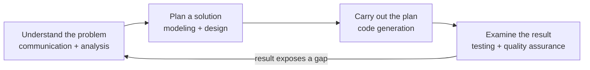
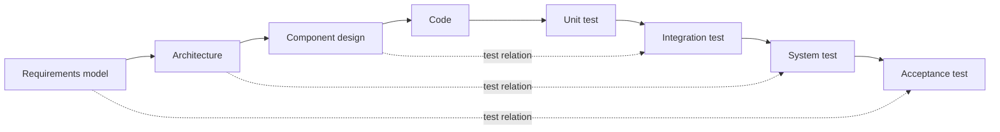
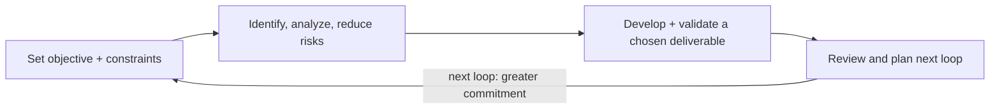

## L01 — Introduction to Software Engineering

Source: `Kuliah/RPL/1.1_Introduction_to_Software_Engineering.pdf` (25 PDF pages). Its printed page numbers agree with PDF page numbers. The deck's central question is how to produce valuable, reliable software economically, rather than simply how to write code. [L01 pp. 3, 12, 24]

### What counts as software, and what counts as an information system?

Software has **three parts**: executable instructions that supply functions and performance; data structures that let instructions represent and manipulate information; and documentation explaining operation and use. A program file alone is therefore an incomplete answer to “what is software?” Documentation includes what operators, maintainers, and users need to use it correctly. [L01 p. 5]

The slide's application categories are system software, application software, engineering/scientific software, embedded software, product-line software, web applications, and AI software. The categories describe **where software is used**, not mutually exclusive implementation technologies: an AI feature can be embedded in a web application. [L01 p. 9]

An **information system (IS)** uses software to create useful information or operational value for an organization. It is a narrower idea than software. A medical-records or tax-filing system is a natural IS example because its central job is handling organizational information; BIOS and an antivirus program illustrate software whose main purpose is different. The same type of IS may need different features in different organizations because goals and workflows differ. [L01 p. 10]

| Distinction | Question to ask | Example |
|---|---|---|
| Software | Are there instructions, data structures, and supporting documentation? | Antivirus program. |
| Information system | Does the software support an organization's information or business work? | Clinic records and appointment workflow. |
| Computer science | What computational theories and mechanisms make a solution possible? | Data structures and algorithms. |
| Software engineering | How do we apply systematic methods to a customer's real problem and maintain the solution economically? | Requirements, design, implementation, and verification of the clinic system. |

The computer-science/engineering relationship diagram places computer-science theories on one side, the customer's problem and desired functions on the other, and software-engineering tools and techniques between them. Refer to [L01 p. 11] to redraw it. A correct reading is that a technically elegant algorithm has little value if it addresses the wrong customer problem. [L01 pp. 11–13]

### Why software behaves differently from hardware

Software is **engineered/developed**, not mass-manufactured in the classical sense: duplicating a finished executable is cheap, but discovering, designing, building, and changing it are costly. Components can be reused, yet much software still needs customer-specific work. These are characteristics of development economics, not claims that no physical media or assembly process is involved. [L01 p. 6]

The hardware “bathtub” failure curve falls after early manufacturing faults, stays low for a while, then rises as parts wear out. The software slide shows an **idealized** curve that falls as defects are removed and remains low. Its **actual** curve rises after changes and spikes when a change introduces side effects; software deteriorates through accumulated changes and defects, rather than physical abrasion. Study the two plotted curves and labeled axes at [L01 pp. 7–8]. A spike after release does not mean the code physically aged; it points to a defect or interaction introduced or exposed by a change. [L01 pp. 6–8]

```text
Failure rate
  ^ hardware: early failures \____ stable ____/ wear-out
  | software: defects fall \___ change! /\___ change! /\__
  +----------------------------------------------------> time
```

### The engineering response: systematic, economic, and quality focused

The deck gives both an early engineering definition—use sound principles to obtain reliable and efficient software economically—and the IEEE formulation: apply a **systematic, disciplined, quantifiable** approach to software development, operation, and maintenance, and study those approaches. “Operation and maintenance” belong in the definition; software engineering does not end when coding ends. “Quantifiable” means the work and its outcomes can be evaluated, not that every design decision has a precise number. [L01 p. 12]

The starting point is the **problem**. A complaint about a slow appointment process might be caused by staffing or approval rules, not merely by the absence of an app. First analyze the situation: decompose it into understandable parts and examine their relationships. Then **synthesize** a solution by combining parts that address the real constraints. Starting with a favorite technology and seeking a place to use it reverses this reasoning. [L01 pp. 13–14]

The layered-technology diagram at [L01 p. 15] is ordered from foundation upward: **quality focus → process model → methods → tools**. Quality focus is a pervasive concern. Process is the foundation that organizes work and management control, determines milestones and work products, gives methods their context, and manages change. Methods supply the technical “how” for communication, requirements analysis, design, construction, testing, and support. Tools automate or assist process and methods. A diagramming tool is not a development process; merely adopting it does not establish review criteria or ensure quality. [L01 pp. 15–17]

| Layer | Provides | Example | Common confusion |
|---|---|---|---|
| Quality focus | Standard for evaluating outputs throughout the project | Defect prevention and review | Treating quality as a final test phase only. |
| Process | Who does what, when, with which entry/exit criteria and products | Iterative delivery cycle | Treating the process as a programming language. |
| Method | Technical technique for a task | Requirements modeling or unit design | Calling a tool a method. |
| Tool | Automated or assisted execution | UML editor or test runner | Assuming automation fixes poor requirements. |

The slide asks whether one can go straight to coding. One can, but trial-and-error success may be difficult to repeat and difficult to coordinate in professional work. The defensible exam answer is about **repeatability, communication, quality, and change control**, not “coding is forbidden before all documentation is complete.” [L01 p. 18]

### Polya's four-step practice loop

The practice diagram at [L01 p. 19] maps a general problem-solving loop to software work:



**Understand** means identify stakeholders, unknowns, required data/functions/features, decomposable subproblems, and a possible analysis model. **Plan** means search for analogous solutions and reusable elements, solve subproblems, and represent the design so it can be implemented. **Carry out** means keep implementation traceable to design and review or prove component correctness where practical. **Examine** means test components, evaluate the testing strategy, compare actual behavior to required data/functions/features, and validate against stakeholder requirements. These are questions to ask, rather than four documents to produce once. [L01 pp. 19–23]

**Verification versus validation:** verification asks whether an implementation or intermediate product conforms to its specification/design; validation asks whether the delivered result satisfies stakeholder needs. The deck explicitly calls for design/code review in carrying out the plan and validation against stakeholder requirements when examining the result. A perfectly implemented but unwanted feature can pass verification and fail validation. [L01 pp. 22–23]

### Solved slide exercises and mini-cases

There is no numbered exercise in this deck. Its question prompts and examples are worked here. [L01 pp. 10, 13–14, 18, 20–23]

**Case 1: “Is it an information system?”** Classify BIOS, antivirus software, a medical-records system, and a tax-filing system. (1) Check first whether each is software; all four are. (2) Check the primary purpose: BIOS initializes and mediates hardware; antivirus detects/removes malicious programs; records and tax systems capture, process, retrieve, and report organizational information. (3) Classify the latter two as clear IS examples. A mistaken answer says every program is an IS because it manipulates data. That criterion is too broad: almost all programs manipulate some data, while the slide distinguishes IS by the value it supplies to an organization's information work. [L01 p. 10]

**Case 2: “Can't we just code?”** A clinic reports long patient wait times and requests an app. (1) Identify stakeholders: patients, front desk, clinicians, administrators. (2) Measure and map where waits occur—appointment allocation, check-in, approvals, or staffing. (3) Decompose the problem and model the current workflow. (4) Select a solution only after discovering the cause; it might include changed scheduling rules and software support. (5) Plan traceable implementation and evaluate actual waiting time and stakeholder acceptance. Coding a booking screen immediately can solve the wrong problem. This applies the analysis/synthesis and Polya questions rather than asserting that every problem needs software. [L01 pp. 13–14, 18–23]

### Quiz traps

- “Software = source code” omits data structures and documentation. [L01 p. 5]
- Software deterioration from change is different from hardware wear-out; know the axes and shapes of both curves. [L01 pp. 6–8]
- An information system is software, but the slide does not classify all software as an IS. [L01 p. 10]
- Analysis breaks down and relates parts; synthesis builds a whole solution from parts. [L01 p. 14]
- The layered diagram's bottom is **quality focus**, then process model, methods, tools. The process layer organizes work; tools support it. [L01 pp. 15–17]
- Testing individual components and validating stakeholder requirements answer different questions. [L01 pp. 22–23]

## L02 — Generic Process Model

Source: `Kuliah/RPL/02. Generic Process Model 1.2.pdf` (25 PDF pages; printed numbers agree where shown). The deck separates **what kinds of work are needed** from **how that work is arranged over time**. [L02 pp. 12–24]

### Process, life cycle, activity, action, and task

A process is a structured sequence of **activities, actions, and tasks** undertaken to make a work product. It answers who does what, when, and how toward a goal. It uses tools and techniques, resources under constraints, linked subprocesses, entry and exit criteria, principles, and intermediate/final products. A software development process is a framework for work needed to build high-quality software. When discussing a product from conception through implementation, delivery, use, and maintenance, the slides also call it a **software life cycle**. [L02 pp. 9–12]

An **activity** is a broad objective, such as communication with stakeholders. An **action** is a coherent set of tasks producing a major work product, such as architectural design. A **task** is a small, defined objective producing a tangible outcome, such as conducting a unit test. A unit test is therefore not a sixth framework activity, and “modeling” is too broad to be one small task. [L02 p. 13]

```text
Activity: Modeling
  └─ Action: Architectural design
       ├─ Task: Identify a component boundary
       └─ Task: Review one interface contract
```

The slides say software engineering is creative **and** stepwise, usually involving many people. It is also iterative social learning: the knowledge gathered during the process becomes part of the product. That explains why a process helps when initial understanding is incomplete. The “Tree Swing Project” on pp. 4–6 depicts different interpretations of a swing, ending with a simple tire swing the customer needed; p. 7 makes the organizational lesson explicit: a polished system can fail if the team never learns how it serves organizational goals. [L02 pp. 4–8]

### Five generic framework activities

These are **Communication → Planning → Modeling → Construction → Deployment** in the overview diagram at [L02 p. 14]. Every process model can arrange or repeat them differently. [L02 pp. 14, 20–23]

| Activity | Key work | Typical output or decision | Source |
|---|---|---|---|
| Communication | Collaborate with customers and other stakeholders; discover objectives, features, functions, and requirements before technical assumptions harden. | Shared problem/requirements understanding. | [L02 p. 15] |
| Planning | Define tasks, likely risks, required resources, expected work products, and schedule in a software project plan. | A practical project “map” to guide and track work. | [L02 p. 16] |
| Modeling | Sketch requirements and design: architecture, components, and how they fit. | Analysis/design models that expose missing or conflicting assumptions. | [L02 p. 17] |
| Construction | Generate code, manually or automatically, and test to uncover errors. | Executable software plus test evidence. | [L02 p. 18] |
| Deployment | Deliver software, let the customer evaluate it, and collect feedback. | Delivered increment and new knowledge for the next step. | [L02 p. 19] |

An exam scenario can span activities. For example, a customer review after deployment creates new communication work, which can change the plan and model. The names describe the **purpose** of work, not a rule that requirements may never change after construction. [L02 pp. 14–23]

### Four process flows and process model qualities

**Process flow** specifies the sequence and timing of framework activities and their internal actions/tasks. Four diagrams show the contrast: linear and iterative on [L02 p. 21], evolutionary on [L02 p. 22], and parallel on [L02 p. 23]. [L02 p. 20]

| Flow | Diagram idea | What changes from the previous flow | Likely quiz cue |
|---|---|---|---|
| Linear | C → P → M → Cn → D | Activities follow one main path. | Sequential stages and one eventual delivery. |
| Iterative | Same path with feedback arrows to earlier work | The team revisits an activity to revise its output. | Testing reveals a design problem and modeling repeats. |
| Evolutionary | An entire cycle returns from deployment/feedback to communication | Repeated cycles produce successively more complete versions. | A usable version leads to feedback and another version. |
| Parallel | Some activities overlap on the timeline | Work can proceed concurrently where dependencies allow. | One part is being modeled while another is built. |

Here **C = Communication, P = Planning, M = Modeling, Cn = Construction, D = Deployment**. Iterative and evolutionary both revisit work, but the [L02 p. 21] iterative diagram emphasizes local feedback links, whereas [L02 p. 22] explicitly loops through delivery to another development cycle. Parallel does not mean no coordination or that construction can precede its necessary design. [L02 pp. 21–23]

A **software process model** is an abstract view of a process from a particular perspective. A useful process should be **visible** (milestones/progress can be seen), **understandable** (activities and order clear), **supportable** (automation available where useful), and **usable** (accepted by developers). A process that looks rigorous on paper but cannot be performed by the team fails the last condition. [L02 p. 24]

### Solved slide exercises and mini-cases

There is no numbered calculation exercise in L02. The deck's visual case and flow diagrams supply the following exam-style interpretations. [L02 pp. 4–7, 21–23]

**Tree Swing Project, pp. 4–7.** (1) Observe that the sales/PR interpretations show attractive, elaborate products, while the last image labels a plain tire swing as the customer's actual need. (2) Identify the failure: different stakeholders transmitted and interpreted the idea without establishing a shared requirement or validating it with the customer. (3) Ask what outcome the customer wants, who will use it, what constraints apply, and what acceptance evidence would demonstrate success. (4) Sketch and confirm a simple prototype or description before planning the full build. (5) After delivery, ask users whether it meets the original need. A common wrong answer is “make the swing more elaborate” or “the developers needed a better tool.” Those responses increase implementation effort without correcting the communication and validation failure. [L02 pp. 4–7, 15, 19]

**Identify the flow.** A team completes deployment, receives feedback, then starts communication, planning, modeling, construction, and deployment for a richer release. That is the **evolutionary** full-cycle pattern of p. 22. A team that returns from construction to revise modeling within one delivery is **iterative** as shown on p. 21. A team whose UI modeling overlaps an independent service build exhibits **parallel** flow as on p. 23. Calling every backward arrow evolutionary misses the diagram's distinction between a local revision and a new delivered cycle. [L02 pp. 21–23]

### Quiz traps

- “Process” is more than a stage list: it specifies people, timing, method, constraints, criteria, and products. [L02 pp. 9–11]
- Activity is broad; action groups tasks to make a major work product; task has a small tangible outcome. [L02 p. 13]
- Memorize the five activity names and order in the generic diagram. Deployment includes customer evaluation and feedback. [L02 pp. 14–19]
- Do not equate an activity with a phase that happens once. The four flows rearrange and repeat the same activity types. [L02 pp. 20–23]
- For a process-model-quality question, distinguish visible milestones, understandable sequence, supportable automation, and actual usability. [L02 p. 24]

## L03 — Prescriptive Process Models

Source: `Kuliah/RPL/03. Prescriptive Process Model-2025.pdf` (49 PDF pages; printed numbers agree where shown). “Prescriptive” means a model supplies defined process elements and an expected workflow; the slides also call these conventional/traditional models. It does **not** mean that every prescriptive model is a purely linear waterfall. [L03 pp. 3–4]

### Waterfall and its variants

**Waterfall** organizes communication, planning, modeling, construction, and deployment as a sequential path; the detailed boxes list requirements gathering, estimating/scheduling/tracking, analysis/design, code/test, and delivery/support/feedback. Redraw the canonical box chain from [L03 p. 6]. The slide states that feedback loops are possible in the proposed model, although mainstream use often treats it as strictly linear. Therefore “waterfall has no feedback under any circumstances” is an overstatement. [L03 pp. 5–6]

Waterfall fits most naturally when requirements are fixed and well understood from the start and work can proceed linearly. Its strengths in the slide are familiar engineering structure, early identification of requirements, visibility of stages, and limited requirements change. Its weaknesses are that projects rarely behave perfectly sequentially, changes are costly midstream, a working product arrives late, design must be specified before programming, and there is a long delay from analysis to delivery. For a changing, uncertain user interface, those weaknesses matter directly. [L03 pp. 7–8]

The **V-shaped model** pairs left-side development work with corresponding right-side assurance work. Read down the left and up the right at [L03 p. 9]: requirements modeling ↔ acceptance testing; architectural design ↔ system testing; component design ↔ integration testing; code generation ↔ unit testing. The diagram's links mean test planning can be traced to earlier specifications and designs. Unit tests target coded units; acceptance tests ask whether the system meets user requirements. Reversing the pairings is a common drawing error. [L03 p. 9]

The **waterfall with prototyping** variant inserts requirements and design prototypes into the staged process, helping validate/verify assumptions before later stages. The diagram at [L03 p. 10] also shows downstream unit/integration, system, and acceptance testing. The **repeating previous stages** variant at [L03 p. 11] shows how a discovered error or changed need forces earlier stage documents to be revised. Thus a feedback arrow is a cost of change and rework, not evidence that waterfall magically becomes a flexible evolutionary model. [L03 pp. 10–11]



### Incremental and phased development

**Incremental development** delivers useful functionality in successive increments. In the slide's word-processor case, release 1 supplies basic text editing and file management, then release 2 adds styling. Each increment may use a small linear development path, while multiple parts or releases may overlap. The diagram at [L03 p. 13] shows staged increments; the phased-development diagram at [L03 p. 14] shows planning followed by repeated analysis/design/implementation leading to system versions 1, 2, and 3. [L03 pp. 12–14]

Select it when requirements are understood well enough to partition into subsystems and users need some capability quickly. Benefits: earlier useful deployment, easier feedback, and lower cost to accommodate changes. Risks: total process progress can be less visible and structure can degrade as increments accumulate unless architecture is maintained. Established bureaucracy can also make frequent releases hard to adopt. “Incremental” means each release **adds usable scope**, not merely that the same unfinished version is repeatedly redrawn. [L03 pp. 15–16]

### Evolutionary development and prototyping

An **evolutionary** model expects the product to change over time: initial needs may be understood, but details and extensions remain uncertain, so iterations create increasingly complete software. The slides warn against treating this as identical to incremental development. A useful distinction is the dominant question: incremental planning partitions known features into delivered chunks; evolutionary work learns and revises uncertain details while the solution matures. Both may produce multiple versions, and a real project may use both ideas. [L03 p. 17]

A **prototype** is an initial system version used to demonstrate ideas, compare designs, and learn more about the problem and possible solutions. It is valuable when requirements are fuzzy because users can react to something concrete. It may be a stand-alone process or a technique inside another model, including the waterfall variant above. [L03 pp. 18, 10]

The Sommerville process at [L03 pp. 19–20] has four steps and four corresponding products: establish objectives → prototype plan; define functionality → outline definition; develop → executable prototype; evaluate → evaluation report. The objective and feature boundary matter because a prototype is an experiment: without specifying what it should teach, feedback is difficult to interpret. The Pressman loop at [L03 pp. 21–22] is communication → quick plan → quick design of user-visible aspects → construct prototype → deliver and obtain feedback → repeat. **Quick design** focuses on the part a user can inspect; it does not prove that the final architecture, security, or performance is complete. [L03 pp. 19–22]

| Prototype approach | What survives? | Why choose it? | Principal danger |
|---|---|---|---|
| Evolutionary/system prototyping | A prototype may be refined into the actual system, shown in [L03 p. 23]. | Feedback can directly steer successive versions. | Shortcut design choices can become permanent. |
| Throwaway/design prototyping | The experiment informs a later, separately designed system, shown in [L03 p. 24]. | Learn about unknown requirements or designs without inheriting rough code. | Stakeholders may mistake the demonstration for a nearly finished product. |

The slides explicitly caution that rushed prototypes often compromise design, users may regard them as the final product, and rapid changes can be poorly documented. Advantages are clearer requirements and more visible progress; disadvantages include less comprehensive analysis and documentation difficulty. Set expectations about the prototype's purpose and fate before showing it. [L03 pp. 25–26]

### Spiral: risk drives every loop

The **spiral model** represents software work as expanding loops, each loop a phase. Its defining feature is **explicit risk management**, not simply that it cycles. The Pressman spiral at [L03 p. 28] overlays communication, planning, modeling, construction, and deployment; the Sommerville diagram at [L03 p. 29] divides a loop into four quadrants: objective setting, risk assessment/reduction, development/validation, and planning. Study the diagrams directly if asked to draw the spiral; the particular sector labels differ between the two illustrations. [L03 pp. 27–29]

For **each loop**: (1) define objectives, constraints, and deliverable, and identify risks; (2) analyze the most important risks and reduce them through an appropriate experiment or decision; (3) choose a development/validation approach for that loop; (4) review results and plan whether/how to proceed. The first loop may produce a specification, a later loop a prototype, then progressively fuller software; plans are adjusted on every planning pass. A risk study is not an optional afterthought following all construction. [L03 pp. 30–32]



Advantages: risks are visible and addressed, the model can span the software life cycle, and it can combine iterative/concurrent elements of other models. Costs: effective risk analysis needs expertise, and customers may need convincing that evolving work remains controllable. A loop without explicit risk assessment is iterative development, but misses the spiral model's defining control mechanism. [L03 p. 33]

### Unified Process: phases, workflows, iterations, and views

The **Unified Process (UP)** is a tailorable framework associated in the slides with Jacobson, Booch, and Rumbaugh; examples of implementations are Rational Unified Process, OpenUP, and Agile Unified Process. Its defining characteristics are **use-case driven**, **iterative and incremental**, and **architecture centric**. Use cases describe user-visible behavior and help organize requirements; repeated iterations grow the product; architecture stays central as a structure for design decisions. [L03 pp. 34–36]

The architecture discussion distinguishes **functional/external view** (what users see the system do), **structural/static view** (classes, attributes, methods, relationships), and **behavioral/dynamic view** (object messages and state changes). The separate five-view diagram at [L03 p. 37] names use-case, logical, process, physical, and development views, with examples of diagram types: UseCaseD, ClassD/SequenceD/CommD, ActivityD, DeploymentD, and PackageD respectively. Do not collapse these two different classifications into one list. [L03 pp. 36–37]

The four UP **phases** describe changing project emphasis: **Inception** establishes business case, preliminary use cases and architecture, and an iterative plan; **Elaboration** understands the domain, expands use cases, creates an executable architectural baseline, reviews scope/schedule, and reduces major risk; **Construction** completes needed models and implements/tests increments (unit, integration, acceptance); **Transition** beta tests and delivers a documented system in its operational setting, including manuals and troubleshooting/install support. The phase illustration is at [L03 p. 38], and the phase descriptions/products at [L03 pp. 41–46]. The work-product table on p. 46 gives concrete artifacts: vision and initial business case in Inception; architecture, risk list, and refined models in Elaboration; software increment, tests, and support documents in Construction; delivered increment, beta reports, and feedback in Transition. [L03 pp. 38, 41–46]

UP **workflows** run across phases: six core workflows are business modeling, requirements, analysis/design, implementation, testing, and deployment; the three supporting workflows are configuration/change management, project management, and environment. The matrix at [L03 pp. 39–40] is essential: columns are phases subdivided into iterations, rows are workflows, and the colored band thickness indicates effort. Requirements and testing can occur in multiple phases; “Inception is only requirements” and “Transition is only deployment” misread the chart. [L03 pp. 39–40, 45]

| UP term | What it answers | Example |
|---|---|---|
| Phase | What lifecycle objective dominates now? | Elaboration reduces architectural risk. |
| Iteration | Which time-boxed cycle produces a reviewable increment? | E2 within Elaboration. |
| Workflow | What type of work is being done across time? | Requirements or testing. |
| Work product | What concrete result is produced? | Use-case model or beta report. |

The slide's UP best practices are develop iteratively, manage requirements, use component-based architectures, visually model software, verify quality, and control changes. These reinforce the phase/workflow matrix: change control and verification continue while versions grow. [L03 p. 47]

### Selecting a process model from project conditions

The [L03 p. 48] Dennis decision matrix grades Waterfall, Parallel, Phased, Prototyping, Throwaway Prototyping, and XP against unclear requirements, unfamiliar technology, complexity, reliability, short schedule, and schedule visibility. It is a heuristic **from the slide**, not a mathematical rule. Its striking pattern is that throwaway prototyping scores excellent on unclear requirements, unfamiliar technology, complexity, and reliability, because it can investigate unknowns before the production build. Regular prototyping scores excellent for unclear requirements and a short schedule, but poorly for unfamiliar technology, complexity, and reliability. Phased development scores excellent for short schedules and schedule visibility. Waterfall scores poorly for unclear requirements and short schedules. [L03 p. 48]

| Condition | Strong candidates in slide matrix | Reason to consider them |
|---|---|---|
| Unclear user requirements | Prototyping, throwaway prototyping, XP | Frequent user feedback or requirement experiment. |
| Unfamiliar technology or high complexity | Throwaway prototyping | Experiment and discard a risky technical design before production. |
| High reliability need | Throwaway prototyping; also structured/phased models graded “good” | Resolve unknowns while preserving deliberate production design. |
| Short schedule | Phased, prototyping, XP | Deliver useful capability or rapid feedback earlier. |
| Schedule visibility | Phased or prototyping | Visible versions/prototypes and checkpoints. |

### Solved slide exercises and mini-cases

L03 contains examples and a selection matrix, not numbered exercises. These are their worked interpretations. [L03 pp. 12, 14, 23–24, 29, 39–40, 48]

**Word processor release plan, p. 12.** (1) List a minimally usable core: type/edit text, open/save files. (2) Implement and release it as increment 1. (3) Put styling into increment 2, then add later features in further increments. (4) Repeat analysis, design, implementation, and user feedback for each release, as the p. 14 phased diagram illustrates. Calling the first increment “a half-built editor that cannot save” fails the useful-software criterion; delivering style before basic editing also misses dependency order. [L03 pp. 12–14, 16]

**Unclear checkout requirements and an unfamiliar payment API.** The p. 48 matrix makes throwaway prototyping the strongest fit for both uncertainty dimensions. (1) State a specific prototype objective: test user checkout steps and the payment API's response/error behavior. (2) Define the limited prototype functionality. (3) build an experimental interface/integration. (4) Evaluate with users and technical probes. (5) preserve learned requirements and design constraints, discard rough prototype implementation, and design the production system. Choosing waterfall solely because it has clear milestones ignores its poor rating for unclear requirements; treating a quick prototype as production risks inheriting shortcuts. [L03 pp. 18–25, 48]

**Select a model when risk is the central concern.** Suppose a safety-critical feature has a new algorithm whose feasibility is unknown. (1) Identify the uncertainty as the major risk. (2) Use a spiral loop to set a measurable objective, run simulation/prototype to reduce risk, validate findings, and decide the next loop. (3) Only then commit to broader construction. Saying “spiral because there are many versions” is incomplete; explicit risk assessment and reduction distinguishes it. The p. 48 matrix separately grades throwaway prototyping highly for reliability and unfamiliar technology; that can be a risk-reduction technique inside a spiral loop. [L03 pp. 27–33, 48]

**Read the UP grid, pp. 39–40.** If a quiz asks whether testing occurs during Elaboration, locate the “Test” row and Elaboration columns: the band is present, even though later phases also test. If it asks whether E1 is a workflow, read the axes: E1 is an **iteration** within Elaboration, while Testing is a **workflow**. Answering that workflows happen strictly one after another contradicts the slide's explicit note and graph. [L03 pp. 39–40, 45]

### Quiz traps

- Prescriptive means an ordered, defined process framework; it does not imply that every prescriptive model is waterfall. [L03 pp. 3–4]
- Waterfall's original description allows feedback loops; mainstream strictly linear use is a narrower practice. [L03 p. 5]
- For the V, pair requirements with acceptance, architecture with system, component design with integration, and code with unit testing. [L03 p. 9]
- Incremental adds useful scope in releases; evolutionary iterations also learn and revise uncertain details. [L03 pp. 12–17]
- A prototype is a learning instrument. State its objective, scope, evaluation, and whether it will be discarded or evolved. [L03 pp. 18–25]
- Spiral = explicit risk assessment and reduction in **each** loop, not just repeated cycles. [L03 pp. 27–33]
- UP phases, workflows, and iterations are different axes. Workflows overlap in time, with changing effort. [L03 pp. 38–45]
- UP's three architecture views on p. 36 and five system views on p. 37 are distinct diagrams; know which a question asks for. [L03 pp. 36–37]
- Read the p. 48 selection matrix by **project condition**, rather than choosing one “universally best” process. [L03 p. 48]
