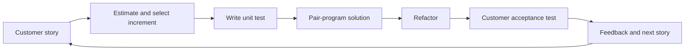
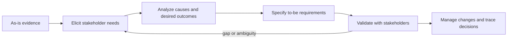
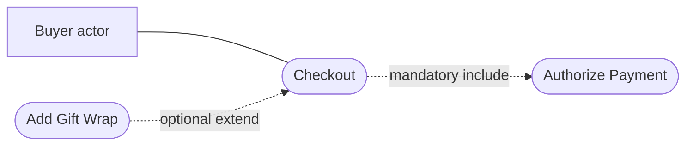
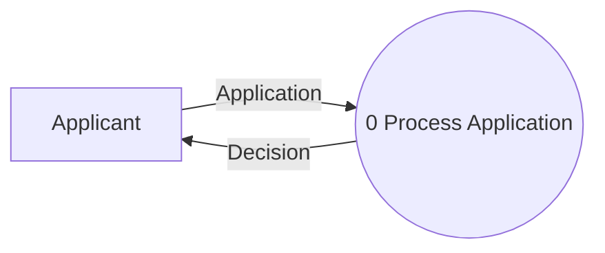
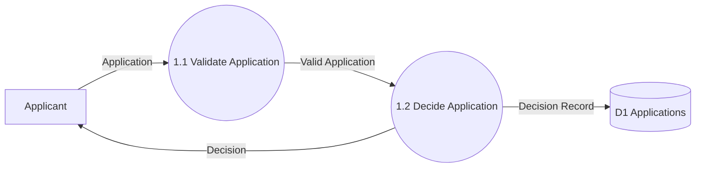
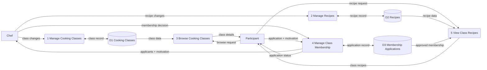
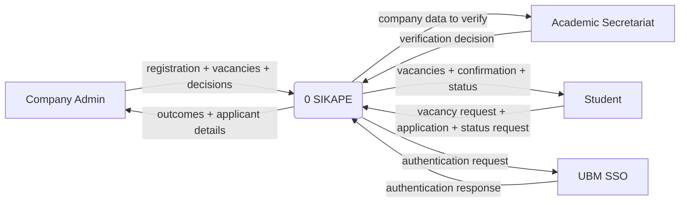

## L04 — Agile Development

**Source:** `Kuliah/RPL/04. Agile Development 25.pdf`, cited as **L04**. Page numbers below are one-based PDF pages (the visible slide numbers match them).

### Why agile exists, and when to choose it

Agility is the ability to respond rapidly and appropriately to change. The deck makes it concrete through stakeholder communication, direct customer involvement, a team that controls its work, and frequent delivery of usable increments. The word *agile* describes this adaptive behavior, not merely short meetings or absence of documentation. [L04 p. 6, p. 9]

| Question | Plan-driven | Agile |
|---|---|---|
| How is work organized? | Separate process stages with defined outputs and formal handoffs. | Requirements, design, implementation, and tests iterate together around working increments. |
| What happens to requirements? | A specification is developed as an input to design; changes usually pass through formal control. | Customer scenarios and feedback evolve alongside design and code. |
| When is it especially suitable? | When complete advance analysis is essential, such as a safety-critical control system. | When the environment changes quickly and customer involvement is available. |

The contrast in the first two rows is the slide's process comparison; the fit examples are explicit on the preceding page. **Neither approach forbids iteration.** Plan-driven work can iterate within an activity; agile iterates *across* activities. [L04 p. 7–9] The cost-of-change illustration [L04 p. 12] is a motivation for early feedback and technical practices: as a change is discovered later, its repair can affect more dependent work. It is a conceptual curve, not a universal numerical law.

The manifesto prioritizes people and interaction, working software, collaboration with customers, and responding to change. Its closing qualification matters: processes, tools, documents, contracts, and plans still have value. The left side receives greater priority when a tradeoff is necessary. [L04 p. 10] Five summarized method principles are customer involvement, incremental delivery, recognition of team skill, embracing change, and simplicity. [L04 p. 11] The complete 12 principles add frequent delivery, daily business/developer cooperation, empowered people, effective conversation, working software as the progress measure, sustainable pace, technical excellence, minimal unnecessary work, self-organization, and periodic reflection. [L04 p. 13–15]

Human factors are part of the mechanism, not optional team decoration: competence, common focus, collaboration, ability to decide amid uncertainty, trust, respect, and self-organization let a short feedback loop work. [L04 p. 16] The slide's examples of agile fit are small or medium products and custom organizational systems with committed customers and few external regulations. [L04 p. 17]

### Extreme Programming (XP)

XP couples small releases with engineering discipline. In **planning**, users describe goals as stories, developers estimate their cost, stories are grouped into an increment, and a delivery commitment is made. After the first increment, measured project velocity helps forecast later increments; it is an empirical planning measure, not a promise that every future story takes the same time. [L04 p. 21–22, p. 26]

In **design**, keep the solution simple (KISS), use Class–Responsibility–Collaboration cards to distribute responsibilities, build a *spike* as a small experiment for a hard technical question, and refactor code to improve internal structure while preserving behavior. [L04 p. 23] In **coding**, the slide places a unit test before code for a story and encourages pair programming. In **testing**, run unit tests daily, while customers define acceptance tests for visible behavior. Unit tests check small code units; acceptance tests ask whether the delivered behavior meets a business need. [L04 p. 25] For the process picture, revisit the XP activity loop [L04 p. 21], the release-cycle diagram [L04 p. 26], and the project map [L04 p. 27].

This is an original teaching sketch of the XP loop, not a copy of a slide.

### Scrum

The **product backlog** is the prioritized set of desired work, informed by customers and other stakeholders; the **sprint backlog** is the work selected for one fixed-length sprint. The deck says sprints normally last one to four weeks. At planning, the team reviews priority and risk and selects work. During the sprint it builds and tests; short daily meetings surface progress and obstacles. At its end, a review/demo presents the increment, then a retrospective evaluates how the team works before the next cycle. [L04 p. 30, p. 33–35]

| Role or event | Responsibility or decision | Common confusion |
|---|---|---|
| Product Owner | Defines and manages product-backlog/business direction; gathers customer and stakeholder input. [L04 p. 32] | Does not replace the development team's technical work. |
| Development/Scrum Team | Works together to deliver the software increment. [L04 p. 32] | The deck stresses team collaboration rather than fixed internal roles. |
| Scrum Master | Organizes the team and Scrum events. [L04 p. 32] | Is not described as the product's business owner. |
| Sprint planning | Chooses sprint work from the product backlog. [L04 p. 33] | Product backlog and sprint backlog are not identical. |
| Daily standup | Makes recent work, upcoming work, and obstacles visible. [L04 p. 33] | It does not substitute for the sprint review. |
| Sprint review | Shows the result and discusses business opportunity. [L04 p. 33–34] | Focuses on the product/increment. |
| Sprint retrospective | Evaluates and improves the team's process. [L04 p. 33] | Focuses on how the team works. |

The larger Scrum life cycle has outline planning (objectives and architecture), repeated sprint cycles, and project closure (documentation/help and lessons learned). [L04 p. 31] The overview and sprint-cycle drawings are on [L04 p. 34–35]. The final list names Adaptive Software Development, Dynamic System Development Method, Crystal, Feature Driven Development, Agile Modeling, and Agile Unified Process without teaching their mechanics; recognize their names but do not infer detailed rules from this deck. [L04 p. 37]

### Solved slide exercises and mini-cases

This deck contains illustrative cartoons and process diagrams [L04 p. 4–5, p. 19–20, p. 24, p. 29, p. 35], but no slide framed as an exercise with a requested answer. Use this applied check: if a project changes its requirements weekly and has an engaged customer, choose short increments and feedback; if a safety-critical system needs complete upfront analysis, justify the plan-driven approach. The reasoning follows [L04 p. 7–9].

### Quiz traps

- “Agile means no plan/documentation” misreads the manifesto's explicit qualification. [L04 p. 10]
- “Plan-driven cannot iterate” ignores within-stage iteration. [L04 p. 8]
- A spike answers a design uncertainty; refactoring improves the internal design without changing promised behavior. [L04 p. 23]
- Unit tests and customer acceptance tests answer different questions. [L04 p. 25]
- Sprint review evaluates the increment; retrospective evaluates team practice. [L04 p. 33]
- A product backlog is the overall desired work; the sprint backlog is selected work for the current sprint. [L04 p. 33–34]

## L05 — Requirement Determination

**Source:** `Kuliah/RPL/05. Requirement Determination.pdf`, cited as **L05**.

### Analysis, requirements, and readership

Requirements work turns an **as-is** system into a clear description of the **to-be** system. Analysis breaks the current whole into parts to understand their functions and relationships, identifies improvements, then defines what the proposed system must do. A requirement states required system behavior or a required characteristic; at analysis time it should express the business person's *what*, with design later specifying more of the *how*. [L05 p. 4–6]

The readers explain why the levels differ. Business/user requirements serve client managers, end users, client engineers, contractor managers, and architects; system requirements serve end users, client engineers, architects, and developers. A high-level promise and a buildable system rule can address the same need at different detail. See the readership map on [L05 p. 7].

| Type | Ask | Examples and grading cue |
|---|---|---|
| Functional | What process, information, or function must the system provide? | “Record an application” or “store applicant grades.” It expresses required capability/data. [L05 p. 8] |
| Nonfunctional | What quality, constraint, or property must the system satisfy? | Response time, security restrictions, integration, portability, or cultural/regulatory fit. The slide groups examples as operational, performance, security, and cultural/political. [L05 p. 8, p. 32] |

The requirements-engineering sequence is **inception** (problem and stakeholders), **elicitation** (discover needs), **elaboration** (model functions, behavior, and information), **negotiation** (priority, cost, risk), **specification** (document/models/scenarios/prototype), **validation** (check validity), and **management** (identify, control, track changes). These activities inform one another; the list is a process map, not proof that a requirement never changes after specification. [L05 p. 9–10]

### Elicitation methods: choose based on the information gap

The methods complement one another because no one source captures every hidden rule. The slide's selection matrix scores type/depth/breadth/integration/involvement/cost; consult it when a scenario asks which technique best fits [L05 p. 25].

| Method | Best use | Procedure and limitation |
|---|---|---|
| Interview | Deep understanding of current work, improvements, and desired work. | Select key stakeholders, design questions, prepare, interview, then send notes back for verification. Move from broad to specific (top-down) or specific to broad (bottom-up), as diagrammed on [L05 p. 15–16]. Depth is high; breadth is low in the deck's matrix. |
| JAD | Jointly resolve and integrate requirements across users, management, and project team. | Facilitator, about 10–20 users, and scribes work in planned sessions with ground rules, source documents, and follow-up. The deck gives about 5–10 meeting days over three weeks. High depth and integration; see room layout [L05 p. 17–19]. |
| Questionnaire | Gather opinions from a broad population, especially external users. | Sample participants, design questions, administer, seek responses, and share results. The deck cautions that response rates are typically well below 50%, so do not assume a response equals population consensus. [L05 p. 20–21] |
| Document analysis | Recover facts about the as-is system. | Read technical materials, training and policy manuals, existing interface, and forms. Handwritten additions and unused fields reveal hidden or obsolete work. Documents may be stale or incomplete. [L05 p. 22] |
| Observation | Find actual behavior people omit or misremember. | Watch normal work without interrupting or influencing it; use alongside interviews. Being observed itself may change behavior. [L05 p. 23] |

Other named gathering aids are throw-away prototyping, role-playing use cases with CRC cards, and mind/concept maps. [L05 p. 24] **Elicitation** discovers requirements; **analysis strategies** explain problems and generate candidates for improvement. Root-cause analysis traces a prioritized problem down a cause tree before proposing a remedy [L05 p. 27]. Problem analysis asks users for present pain and possible remedies. Duration analysis compares time spent in steps with total elapsed time to expose waiting and possible parallelism; activity-based costing applies a similar lens to money. Benchmarking studies similar successful organizations, outcome analysis starts with desired customer results, technology analysis examines new technical opportunities, and activity elimination asks what happens if an activity is removed. [L05 p. 28–29]

### Writing and validating a good requirement

A strong requirement is correct, unambiguous, complete, consistent, verifiable, modifiable, traceable, and ranked for importance. [L05 p. 33] “Correct” needs stakeholder confirmation; “verifiable” needs an observable pass/fail condition; “traceable” needs an identifier and links to its source and later design/test. A requirement can pass one property and fail another.

The slide's bad unknown-source statement has two readings: does approval allow installing software from an unknown source or forbid it entirely? It is also phrased as a difficult-to-test negative and lacks an identifier. The proposed rewrite assigns an ID and states the positive gate: installation occurs only after testing and approval. [L05 p. 11] The “ASP” example is ambiguous until the acronym is expanded. [L05 p. 34] “Do not accept passwords over 15 characters” leaves three different behaviors possible: prevent extra typing, truncate silently, or show an error. The slide selects the error-and-correction behavior. [L05 p. 35]

### Solved slide exercises and mini-cases

**Bad requirement [L05 p. 11].** (1) Identify the required outcome: unapproved software must not be loaded. (2) List alternate readings of “unknown sources”; this reveals ambiguity. (3) Rewrite as an observable gate with unique ID, e.g. `REQ-3.4.5.2: The operational system shall permit software loading only after a recorded test and approval.` (4) Derive a test: attempt loading before and after recorded approval. The slide's own rewrite omits the word *recorded*; that added detail is a proposed testability refinement, not a slide fact. A student answer merely replacing “will not” with “shall not” leaves the ambiguity and weak testability.

**Interview funnel [L05 p. 16].** To investigate returned orders, begin with “How can order processing improve?” then narrow to “Why are customers returning orders?” and finally “Which steps cause wrong products to be shipped?” Reverse that sequence for a bottom-up interview. A single precise question may miss an unexpected root cause; a single broad question may produce no actionable detail.

**Ambiguous acronym [L05 p. 34].** Expand “ASP” to the intended full term, *Active Server Pages (ASP)*. Asking a developer to guess from context fails because “Application Service Provider” is another plausible reading.

**Password limit [L05 p. 35].** Select and specify one outcome: when a user chooses a password longer than 15 characters, show an error and request correction. Do not silently truncate unless stakeholders choose that behavior; the original sentence did not specify it. A test should enter 16 characters and observe the error and rejected submission.

The nonfunctional table [L05 p. 32] is an example classification exercise: “interaction under two seconds” is performance; “only direct managers can see personnel records” is security; “integrate with existing inventory system” is operational compatibility; “distinguish US and European currency” is cultural/operational localization. Each imposes a property rather than naming a business transaction.

### Quiz traps

- “The system shall use a SQL table” names a design choice; early user requirements should foreground the business outcome. [L05 p. 6]
- “Fast,” “secure,” or “easy” without a measurable condition is hard to verify. Compare the explicit two-second performance example. [L05 p. 32–33]
- A nonfunctional requirement can concern security, integration, cultural fit, or performance; it is not synonymous with “optional.” [L05 p. 8, p. 32]
- An identifier improves traceability but does not cure ambiguity. [L05 p. 11, p. 33–35]
- Observation checks actual work yet can alter it; interviews reveal reasons but may omit routine actions. Combine them when needed. [L05 p. 15, p. 23]
- Root-cause analysis seeks the causal chain before selecting a solution; “buy new software” is not a root cause. [L05 p. 27]

## L06 — Functional Modeling

**Source:** `Kuliah/RPL/06. Functional Modeling 25.pdf`, cited as **L06**.

### What the functional model answers

Analysis modeling asks who uses the system, what the system does, where its boundary lies, and how actors and system interact. This deck groups activity diagrams, use-case diagrams, and descriptions as *functional* models; CRC cards and class/object diagrams as *structural* models; and sequence, communication, state, and CRUD models as *behavioral* models. [L06 p. 5–7] Use cases expose user goals in terms stakeholders can discuss and help separate what they want from what the new system truly needs. [L06 p. 9]

A **system boundary** box identifies the modeled system. An **actor** is an external role (human or another system), not necessarily a particular person. A **use case** is a goal-sized service the system performs that benefits an actor. Put actor icons outside the boundary, goal ellipses inside, and association lines between participants and goals. The notation templates are on [L06 p. 10–12]; worked housing and library examples are on [L06 p. 22–23]. [L06 p. 13–15]

| Relation | Meaning | Arrow direction / use |
|---|---|---|
| Actor–use case association | Actor participates in a goal. | Solid line between actor and use case; a line alone does not specify every message or who initiates it. [L06 p. 11, p. 14] |
| `«include»` | Base use case mandatorily invokes reusable behavior. | Dashed arrow from **base** to **included** use case. [L06 p. 12, p. 18] |
| `«extend»` | Optional/conditional behavior augments a base use case at an extension point. | Dashed arrow from **extension** to **base** use case. [L06 p. 12, p. 18] |
| Generalization | Child actor/use case inherits parent participation/behavior and adds specialization. | Hollow triangle points toward the **parent**. Actor example: `Student` and `Academic Advisor` specialize `User`. [L06 p. 16–18] |

The sketch conveys direction and purpose; redraw with official UML stick figures, ellipses, solid association, dashed labeled arrows, and a system boundary in a graded UML diagram. [L06 p. 10–12]

**Identify goal-sized use cases systematically.** Read the requirements, set the system boundary, list external actors and their goals, find the major business processes, then split, merge, or package use cases until each expresses a coherent user goal. [L06 p. 19–21] A step such as “enter username” is too small. Physical delivery outside the software boundary is too large in the wrong domain. Multiple actor roles may interact with a use case, but say clearly which actor initiates and which supports it, particularly when a gateway participates. [L06 p. 24–35]

### Use-case specifications: behavior in words

Three depths are taught: **terse** one-paragraph success summary, **casual** informal main and alternate scenarios, and **fully dressed** numbered steps with preconditions, postconditions, stakeholders, and variants. Process Sale and Handle Returns show the progression [L06 p. 41–44]. A specification can contain name, description, primary/secondary actors, preconditions, postconditions, optional parent and include/extend relations, and basic and alternative event flows. The fully dressed template is on [L06 p. 44–45]; the two-column actor/system event layout is on [L06 p. 53–55].

The **basic flow** says what starts the goal, each meaningful actor action and system response, any repeat, and its successful end. **Alternative flows** branch at a numbered step for variants, optional behavior, blocked resources, and failures, then say whether they resume or terminate. [L06 p. 46–48, p. 56] **Preconditions** are states already true before the case starts. Requiring an authenticated session is a precondition when login need not be repeated with each goal. **Postconditions** describe the resulting state, not just a screen message. [L06 p. 37, p. 45]

Write an *essential, black-box* account of externally visible behavior: “system records sale” belongs; “system issues SQL INSERT” exposes implementation. The deck also asks for precise actor actions, no vague adverbs, a clear start/end and loop, and coverage of all functional requirements. A use-case specification is not merely a screen or control inventory. [L06 p. 49, p. 56] The ATM withdrawal flow [L06 p. 50–52] and sale table [L06 p. 53–55] are examples to study for step numbering and actor/system alternation; their UI-specific phrasing does not override the more general black-box writing rule [L06 p. 49].

### Solved slide exercises and mini-cases

**Case 1 — Login [L06 p. 24–25].** Identify external role `User` and goal `Log In` (or `Authenticate User`). Associate User with that use case. In its flow, the user provides a username and password; the system validates them and establishes an authenticated session or rejects the attempt. “Enter Username” and “Enter Password” are steps, not separately valuable system goals; making each a use case creates a diagram of interface gestures instead of actor goals.

**Case 2a — Shared schedule view [L06 p. 26–27].** Both `Lecturer` and `Student` independently want to `View Course Schedule`. Show each actor associated with the use case, or make both specialize a `User` role associated with it if their shared role is useful. The slide warns that a shared use case can be misread as simultaneous coordination. State explicitly in the specification that either actor may initiate independently. Do not turn the actors into a two-person prerequisite or duplicate identical goal ellipses merely to avoid a shared line.

**Case 2b — Buyer and gateway [L06 p. 28–29].** `Buyer` initiates `Checkout`; `ABC Payment Gateway` is an external supporting actor that exchanges payment-authorization data with the system during checkout. Show both associations if gateway interaction is part of the use case, then label Buyer as primary and gateway as secondary in the specification. The diagram alone can obscure initiation, so do not say the gateway initiates checkout or that buyer and gateway jointly start it.

**Case 3 — Optional receipt [L06 p. 30–31].** `Customer` initiates `Transfer Funds`. `Print Receipt` is optional only at the transfer's final decision point, so model `Print Receipt` as an `«extend»` of `Transfer Funds` under condition `customer requests receipt`; connect Customer to Transfer Funds. Avoid an independent Customer–Print Receipt association if the intended meaning is that receipt printing cannot be launched at arbitrary times. A student answer making receipt an `«include»` would make it mandatory.

**Case 4 — Balance independently and within transfer [L06 p. 32–33].** Associate `Customer` with both `Check Balance` and `Transfer Funds`, because balance can be checked at any time. Model the automatic balance display at transfer's end as a mandatory reuse of balance behavior (`Transfer Funds «include» Check Balance`) if `Check Balance` represents that same behavior, or document the display as a mandatory step in Transfer Funds if the goal-sized case differs. Crucially, retain the direct Customer–Check Balance association; omitting it falsely removes the independent goal. [L06 p. 18]

**Case 5 — Courier status [L06 p. 34–35].** Outside the software, the courier physically delivers a package. Inside the expedition system, the courier updates package status at pickup and arrival. Model `Courier — Update Package Status`, with pickup and arrival as status variants/steps unless they require distinct goal flows. Do not draw `Deliver Package` inside the system boundary; that would claim the software performs a physical act. [L06 p. 10, p. 15]

**Case 6 — Login as precondition [L06 p. 36–37].** Connect `Student` to `View Course Page`, `View Assignment`, and `Upload Assignment`. Specify `authenticated session exists` as a precondition for each. `Log In` may still be a separate use case. Making every goal `«include» Log In` says login runs each time the student views or uploads, contrary to the scenario. The visible mistake example on [L06 p. 37] is about execution semantics, not a ban on login use cases.

**KelasResepi use-case diagram [L06 p. 38].** (1) Define boundary `KelasResepi`. (2) Model roles `Chef` and `Student`; a single person may play both. A shared `User` parent can carry common viewing goals. (3) Connect Chef to `Open Cooking Class`, `Manage Cooking Class`, and `Manage Recipe`; opening more than one class is a data cardinality/business rule, not multiple identical use-case icons. (4) Connect User to `View Cooking Class List` and `View Cooking Class Detail`; because the detail is selected from the list in this story, represent `View Cooking Class List` as an initial step in the detail flow or show `View Cooking Class Detail «include» View Cooking Class List` if that navigation is always required. The slide does not prove every future path to details requires a list, so the step-based reading is safer. (5) Connect Student to `Enroll in Cooking Class`; Chef can do the same *in the student role* for another chef's class. Record the constraint `chosen class is available and applicant is not that class's chef`. (6) Connect User/participant to `View Class Recipes`, with `enrolled in this class` as a precondition. (7) `Manage Recipe` is an optional continuation from `Manage Cooking Class`, so `Manage Recipe «extend» Manage Cooking Class` describes that branch; retain an independent Chef–Manage Recipe association only if recipes can also be managed directly. Do not draw `Manage Cooking Class «include» Manage Recipe`, which would make optional work mandatory. Do not restrict all chefs from enrolling; the prohibition applies only to their own class.

**SIKAPE use-case diagram [L06 p. 39].** (1) Boundary `SIKAPE`; actors `Company Admin`, `Academic Secretariat`, `Student`, and the external `UBM SSO` service. (2) `Register Company` must be accessible to an unauthenticated prospective Company Admin; connect it directly and omit a login precondition. (3) `Verify Company` belongs to Academic Secretariat. Successful verification enables later login and company features; represent that as a postcondition and later precondition, not as a mandatory included case during registration. (4) `Log In via SSO` involves the relevant user and SSO as supporting external actor. Authenticated session is a precondition for the protected goals; do not include login in every one. (5) Company Admin can `Open KP Vacancy`, `View Applicants`, `View Applicant Detail`, and `Update Application Status`; allowed status changes include processed/rejected and, after interview, accepted. (6) Student can `View Available Vacancies`, `Apply for Vacancy`, and `Track Application Status`. The flow says a vacancy is chosen from the list and an applicant is chosen from a company's list, so detail/view operations can be flow steps unless the lecturer expects separate reusable goals. (7) Ensure data restrictions: a company sees applicants for its own vacancies; a student sees their own status. Avoid connecting Student to company verification or Company Admin to student application submission. The text does not state whether SSO also authenticates prospective company admins before registration; its explicit exception says registration needs no login, so do not impose one.

**Tutor Information System basic flow [L06 p. 57].** Scope `TIS`, primary actor `Student`, supporting actor/system `AIS`; precondition: student can access application and a selectable vacancy exists. This is an original completion of the brief scenario; it does not invent selection criteria or teacher approval.

| Step | Student action | TIS response |
|---|---|---|
| 1 | Selects a vacancy. | Shows its details and makes applying possible. |
| 2 | Chooses Apply. | Requests the applicant's prerequisite grades from AIS. |
| 3 | — | Receives the grades, associates them with this application, and stores them in TIS for the teacher to review. |
| 4 | — | Records the application and displays “application success”; the use case ends. |

The postcondition is a stored application linked to the applicant, vacancy, and prerequisite grades. If AIS is unavailable, do not show success before deciding how the missing grades are handled; the slide does not define a retry policy, so mark that as an open alternative. “Teacher creates a vacancy” belongs to another use case; placing it in Apply for Vacancy confuses prerequisite with current goal.

**Food delivery `Order Food` [L06 p. 58].** The slide requests outside benchmarking but names no product, so the following is a representative model, not a claim about a specific app. Precondition: customer can browse a serviceable restaurant. Postcondition on success: an order with items, delivery address, payment choice/authorization, and status has been stored and acknowledged. Basic flow: (1) Customer selects restaurant. (2) System shows available menu and prices. (3) Customer adds items; system updates cart and total; repeat 2–3 as needed. (4) Customer supplies/chooses delivery address and reviews fees and final total. (5) Customer chooses payment method and submits. (6) System validates availability, service area, total, and payment authorization where applicable. (7) System records order, sends it to the restaurant, and confirms order identifier/status. Alternative branches: unavailable item → request replacement/removal and return to cart; address outside range → request another address or end without placing order; payment denied → allow another method without creating a successful order; restaurant declines → inform customer and transition the order to rejected/refund handling per policy. An answer that declares “order successful” immediately after tapping Pay skips validation, storage, and confirmation. A complete flow must state start, loop, end, and failure branches [L06 p. 47–49, p. 56].

### Quiz traps

- Actor means external *role*. The same human can be Chef for one class and Student for another. [L06 p. 13, p. 38]
- Actor-to-use-case association shows participation, not necessarily who starts the goal; use primary/secondary labels in the specification. [L06 p. 28–29, p. 45]
- `«include»` is mandatory; `«extend»` is conditional; generalization specializes a parent. Arrow direction matters. [L06 p. 12, p. 16–18]
- A precondition such as an existing login session is not an included login sequence. [L06 p. 36–37]
- Steps (“enter username”) and offline acts (“deliver package”) fail the goal/boundary tests. [L06 p. 24–25, p. 34–35]
- A use-case diagram is a map of goals and relations; a fully dressed specification explains one goal's actual sequence, guards, alternatives, and guarantees. [L06 p. 10–12, p. 41–48]
- “Display checkbox” and “write to SQL table” describe UI/implementation, while the analysis specification should describe intent and system obligation. [L06 p. 49, p. 56]

## L07 — Process Modeling

**Source:** `Kuliah/RPL/7. Process Modeling (2) (1).pdf`, cited as **L07**.

### What a DFD models

A process model formally describes business activities and movement of data. A **logical** model says what transformations occur without prescribing implementation; a **physical** model adds build-relevant details. A data flow diagram (DFD) is the deck's notation for integrating processes and the data exchanged among them. [L07 p. 5–6]

| Element | Meaning and naming | Direction/check |
|---|---|---|
| Process | Business function named **verb + noun**, e.g. `Validate Application`. A process generally expresses one activity; avoid `and` chains. | Needs at least one input and output. Number and describe it. [L07 p. 8, p. 35] |
| Data flow | One data item or coherent packet named as a **noun**, e.g. `Application Details`. | Arrow is one-way and touches a process at one or both ends. [L07 p. 9, p. 36] |
| Data store | Persistent collection named as a **noun**, e.g. `D1 Applications`. | Incoming arrow adds/updates; outgoing retrieves. The slide's validation checklist expects input and output. [L07 p. 10, p. 36] |
| External entity | Role or system outside the modeled system, e.g. `Student` or `SSO`. May be inside the organization yet external to the software boundary. | Supplies or receives data via a process. [L07 p. 11, p. 36] |

The symbol templates and reading example are on [L07 p. 12–13]. A DFD arrow carries **data**, not control or temporal order; draw `Application`, `Decision`, or `Status`, not `Click Button` or an unnamed arrow. There should be no direct entity-to-store or store-to-store flow because data must pass through a process. [L07 p. 8–11, p. 35–36]

### Hierarchy and balancing

Start with a **context diagram**: one process `0` for the entire system, every relevant external entity, and all system-boundary input/output flows. A **level 0** diagram decomposes process `0` into major processes and adds stores. A **level 1** diagram decomposes one level-0 process; level 2 decomposes a level-1 process where needed. Numbering reveals parentage: process `3` can become `3.1`, `3.2`, `3.3`. The children together must perform their parent's complete transformation. [L07 p. 14–19, p. 25–34]

**Balance** means a parent process's external input and output interface is preserved when that process is opened up: each crossing flow must appear at the child boundary with the same data meaning and direction. Internal child-to-child flows may be newly exposed by decomposition. The deck's [L07 p. 37] wording says no new lower-level flows or stores appear absent from the parent, which is stricter than its own statement that level 0 adds stores [L07 p. 17] and level 1 shows internal processes [L07 p. 18]. For exams, preserve all parent boundary flows and ask whether the instructor wants stores repeated verbatim; never delete a boundary flow or invent an unexplained new external boundary flow. The balancing illustration to redraw is [L07 p. 14–19, p. 37], and the CD Selections context/level-0/level-1 chain is [L07 p. 39–42].

The diagrams show the same `Application` input and `Decision` output at the external boundary; the valid-application handoff and store update appear inside the child. These are original illustrations, not slide copies.

### Build and validate

Build the context diagram from use-case inputs and outputs, make a fragment for each use case, combine fragments into level 0, decompose selected processes, and review with users. Use-case names often become process names after adjustment to a clear verb phrase; small related inputs and outputs may be combined into one logical flow. Layout conventions put input at left, output at right, process in the center, and stores below, but legibility is the aim. [L07 p. 24–34] The deck suggests roughly 3–7 processes per DFD in its validation checklist [L07 p. 35] and mentions 3–7 to 9 as a decomposition heuristic [L07 p. 34]; treat these as diagram-management guidance, not a reason to create filler processes.

| Validation | Question | Source |
|---|---|---|
| Syntactic | Is every process uniquely named/numbered and supplied with input and output? Are flows noun-labeled, one-way, connected to a process? Are stores and entities named and connected? Are diagrams balanced and consistently decomposed? | [L07 p. 35–37] |
| Semantic | Does the diagram accurately describe the real/intended business, including conditions, ownership, and information meaning? | [L07 p. 38] |

Syntax can be perfect while semantics are wrong: a company-admin arrow labeled `Application` to an “Approve Application” process might be well-formed but false if only the academic secretariat has approval authority. Use walkthroughs, role-play, and careful terminology to validate meaning. [L07 p. 38] Alternative output data flows for different conditions are allowed; the process description explains the conditions. Complex logic may require structured English, a decision tree, or a decision table beyond what arrows can express. [L07 p. 20, p. 22]

### Solved slide exercises and mini-cases

**“Your Turn” [L07 p. 21].** A *process* transforms incoming data for a business purpose, a *data flow* is information moving between a process and another node, and a *data store* keeps information for later retrieval. They are not interchangeable: `Application` as an arrow is a flow; `D1 Applications` as a persistent repository is a store; `Evaluate Application` as an action is a process. The DFD is an analysis blueprint for what information the eventual application must receive, transform, remember, and send. It guides later design but does not prescribe screens, code classes, network calls, or database technology. Calling a DFD a sequence of UI screens misses its data viewpoint. [L07 p. 5–11, p. 24]

**KelasResepi context and level 0 [L07 p. 44].** The exercise extends the use-case story [L06 p. 38] with motivation and chef approval/rejection. A defensible context diagram has process `0 KelasResepi` and external role entities `Chef` and `Participant` (a person may play both roles). Inputs: chef's class/recipe changes and membership decisions; participant's catalog/detail requests, application with motivation, recipe request, and status request. Outputs: class list/details, application/participant details with motivations to the owning chef, application status to participant, and recipes to an enrolled participant. Keep authentication, payment, and notifications out: the scenario does not state them.

For level 0, one coherent decomposition is `1 Manage Cooking Classes` (class records), `2 Manage Recipes` (recipe records tied to classes), `3 Browse Cooking Classes` (list/detail), `4 Manage Class Membership` (application/motivation, chef decision, participant status), and `5 View Class Recipes` (enrollment check and recipe output). Stores can be `D1 Cooking Classes`, `D2 Recipes`, `D3 Membership Applications`. Connect all external flows from the context to their matching major process; use named store flows such as `Class Record`, `Recipe Record`, `Application Record`, and `Enrollment Decision`. The chef's optional transition from class management to recipe management is a user navigation choice, not a mandatory data-flow arrow; a DFD records data dependencies rather than UI sequence. A role restriction requiring a chef to manage only owned classes is part of process semantics. [L06 p. 38; L07 p. 8–11, p. 17, p. 44]

This original level-0 sketch shows the **ownership of data exchanges**; the full exam diagram should also label any class/recipe status confirmations required by the exact prompt. The parent context must expose the same external exchanges. [L07 pp. 25–37, 44]

**KelasResepi level 1 of `4 Manage Class Membership` [L07 p. 44].** Preserve its parent inputs/outputs: application plus motivation from Participant; participant list/details and motivation to Chef; decision from Chef; status to Participant. Decompose as `4.1 Record Membership Application` (validate class availability and that applicant is not its owner; store applicant, class, motivation, pending status in D3), `4.2 Show Membership Applicants` (read D3, return only the chef's class applicants and motivations), `4.3 Decide Membership Application` (read D3, take approve/reject decision, update D3), and `4.4 Report Membership Status` (read D3, output the participant's own current status). If class availability is checked, read `D1 Cooking Classes` as an internal reference. The phrase “already registered as a participant” in [L06 p. 38] does not specify whether pending applicants can view recipes; the conservative interpretation is approved enrollment. Do not output recipe content in this membership subprocess; that belongs to process 5. Do not model the chef's approve/reject decision as if the system makes it autonomously.

**SIKAPE context and level 0 [L07 p. 45].** External entities are `Student`, `Company Admin`, `Academic Secretariat`, and `UBM SSO`; SSO is another system outside SIKAPE, even though it is integrated. Process `0 SIKAPE` accepts company registration, company verification decision, vacancy details, vacancy/application/status inquiries, student application, admin processing/rejection/acceptance decisions, and SSO authentication response; it returns registration/verification outcome, vacancy list, application confirmation/status, applicant list/details, and authentication request to SSO. Do not require SSO before unauthenticated company registration. A level-0 decomposition can be `1 Register and Verify Company` (registration plus secretariat decision; split into two processes if a rubric penalizes “and”), `2 Authenticate User` (SSO exchange), `3 Manage Vacancies`, `4 Browse and Apply for Vacancy` (split if enforcing one activity per process), and `5 Manage Applications` (admin view/decision and student status). Better exam-safe verb+noun names are `1 Register Company`, `2 Verify Company`, `3 Authenticate User`, `4 Manage Vacancies`, `5 Browse Vacancies`, `6 Record Application`, `7 Manage Applications`; a seven-process level 0 is within the deck's heuristic. Stores: `D1 Companies`, `D2 Vacancies`, `D3 Applications`, plus a session record only if the intended system persists sessions. Keep company approval as a condition for opening vacancies and restricting company admins to their own applicants. No grade retrieval or interview scheduling is stated in this SIKAPE scenario. [L06 p. 39; L07 p. 8, p. 17, p. 35, p. 45]

This original **context** sketch deliberately has one process and no internal store. When drawing the level-0 answer, split that process into the seven named processes above and connect their store flows while keeping the external boundary exchanges. [L07 pp. 16–18, 25–31, 45]

**SIKAPE level 1 of `7 Manage Applications` [L07 p. 45].** Preserve boundary inputs/outputs from process 7: company admin request for own vacancy's applicant list/detail, decision `processed/rejected/accepted`, student status request, and corresponding lists/details/status results. Decompose as `7.1 Retrieve Applicants` (read D3 by the admin's vacancy), `7.2 Retrieve Applicant Detail` (read D3 for selected applicant), `7.3 Update Application Status` (validate owner and permitted transition, write D3), `7.4 Report Application Status` (read D3 for the student and output own status). The text ties *accepted* to post-interview state but does not define an interview-record input, so record “interview completed” as an explicitly assumed condition or open business rule rather than draw an invented interview subsystem. If `Record Application` lives in level 0 process 6, do not re-create submission as a child of process 7. A semantic mistake is to let the company inspect other companies' applicants; a syntax mistake is to connect Company Admin directly to D3 without a process. [L06 p. 39; L07 p. 8–11, p. 35–38, p. 45]

The CD Selections hierarchy [L07 p. 39–42] is a slide **example**, not an unanswered exercise. The diagrams illustrate that context boundaries persist through level 0 and that a major process can be opened into a level 1. Use them as a drawing template for numbering and balance, without copying their business entities into the KelasResepi or SIKAPE answers.

### Quiz traps

- DFD processes need **verb + noun** labels; data flows, stores, and external entities take nouns. Avoid an action label such as `Send Data` on a data arrow. [L07 p. 8–11]
- Every flow touches a process; every process needs input and output. A direct actor-to-store arrow bypasses the transformation. [L07 p. 8–9, p. 35–36]
- Use separate arrows for opposite directions; a two-headed arrow fails the slide's syntax checklist. [L07 p. 36]
- A context diagram has one process `0` and boundary entities/flows; stores first appear at level 0 in the deck's hierarchy. [L07 p. 16–17]
- Balance the same **boundary information and direction** at parent and child. New internal handoffs become visible as you decompose; never invent or lose an external exchange. [L07 p. 14, p. 17–18, p. 37]
- Use-case `«include»`/`«extend»` expresses goal dependency; DFD arrows express data. Do not copy UML relationship arrows into a DFD. [L06 p. 18; L07 p. 9, p. 24]
- Syntax asks whether notation is well formed; semantics asks whether it tells the true business story. Both must pass. [L07 p. 35–38]
- A logical DFD describes data transformation without committing to screens, SQL, or a specific integration architecture. [L07 p. 6]
