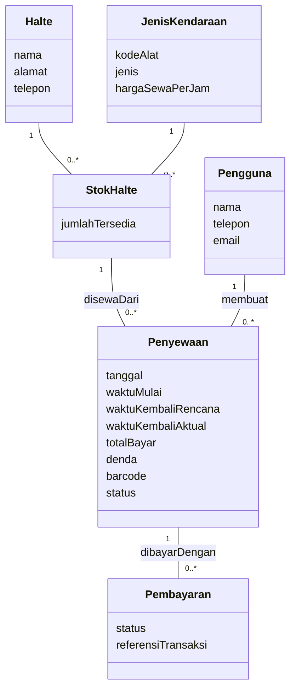
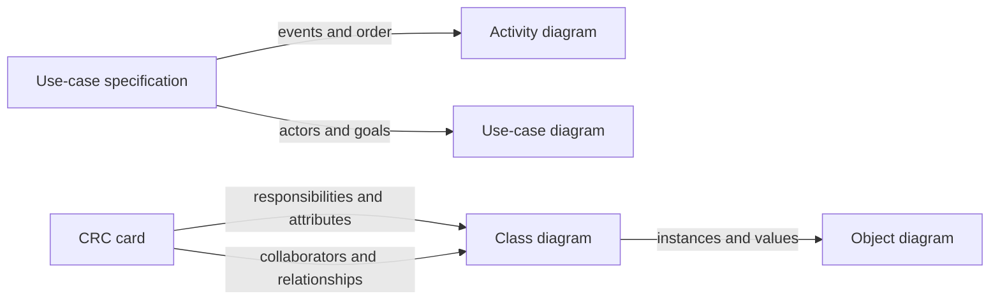
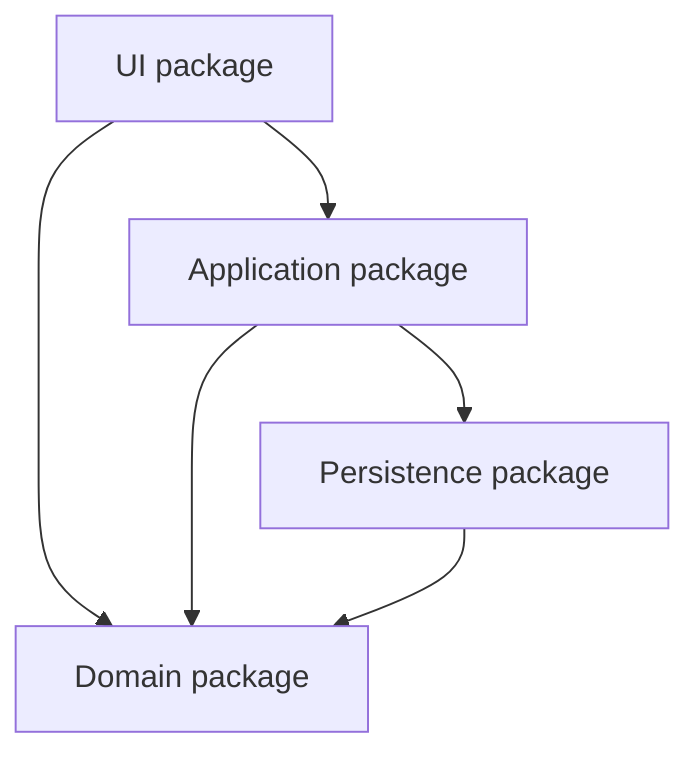

## L08 — Structural Modeling with Class Diagrams

*Source: `08. Structural Modeling (1).pdf`. Page citations here are one-based PDF pages; this deck's printed slide numbers agree with them.*

### Conceptual breakdown

#### Why a structural model exists

Functional models explain **what happens**: use cases show services visible to actors, while DFDs show movement and transformation of data. A structural model asks **what domain facts must persist, and how those facts are related**. DFD processes and stores can suggest classes, but they do not mechanically determine them. Model the domain first, then refine it with technology details in design. This iterative route reduces the semantic gap between a real business and its software representation. A shared vocabulary is a practical outcome: `Pembelian` must mean the same thing to users, analysts, and developers. [L08 pp. 5–10]

| Model | Main question | Typical element | Common mistake |
|---|---|---|---|
| Use case | What goal can an actor achieve? | Actor, use case | Treating a use case as a stored class automatically. |
| DFD | What data moves and how is it transformed? | Process, flow, store | Turning every flow into a class. |
| Class diagram | What types of things and relationships are kept? | Class, attribute, association | Drawing a relationship whose link is never stored. |
| Object diagram | What is one concrete snapshot? | Named instance with values | Using a class name without an instance or actual values. |

A **class** is a template for objects; an **object** is one instance. An **attribute** records state about each instance, and an **operation** is behavior that the class can perform. For example, `Penyewaan` is a class, `sewa-481:Penyewaan` is an object, `waktuKembaliAktual` is an attribute, and `hitungDenda()` is an operation. A class diagram names types and constraints; an object diagram instantiates them with attribute values and links at one time. [L08 pp. 11, 23, 39]

#### Discovering classes and assigning responsibility

Read use-case descriptions for nouns that *might* be classes and verbs that *might* be operations, then challenge each candidate. A noun could be an attribute (`alamat`), an actor whose identity need not be stored, a temporary input, or a genuine domain class. Brainstorm physical things, incidents such as a payment, roles, interactions, and known patterns. Actors are candidates, not automatic classes; an actor generalization can suggest class generalization only when the corresponding persisted domain concepts have true “is a” semantics. Actors connected by use cases can suggest an association, but retain it only when the relationship matters to stored business facts. [L08 pp. 14–17, 45]

CRC means **Class–Responsibility–Collaboration**. “Knowing” responsibilities concern information an object owns; “doing” responsibilities concern work it performs. A collaborator is another object whose service is needed to fulfill a responsibility. The front card example contains class identity, description, associated use cases, responsibilities, and collaborators [L08 p. 20]; the reverse contains attributes and relationships [L08 p. 21]. Role-play a use-case scenario by handing a request to a card: if the card cannot answer without reaching into unrelated data, revise responsibilities or collaborators. Convert responsibilities into class operations, attributes into class attributes, and collaborators/relationships into appropriate diagram relationships; the cross-model checks are made explicit in [L09 pp. 11–12]. [L08 pp. 18–21, 37]

The structural modeling sequence in the deck is: create CRC cards; examine common object lists; role-play cards; create a class diagram; review it; incorporate useful patterns; review the resulting model again. The transaction pattern suggests separate transaction, line item, item, location, and participant roles when the domain requires them. A pattern is a prompt to investigate, not a command to create all five classes. [L08 pp. 36–37]

#### UML class notation and relationships

The standard class box has **name**, **attributes**, and **operations** in top, middle, and bottom compartments. `+` denotes public, `-` private, and `#` protected visibility. A slash before an attribute, such as `/total`, denotes a value derived from other facts. An operation has parentheses and can include arguments; constructors create objects, queries reveal state, and updates change state. See the drawable class template [L08 p. 23] and visibility/operation rules [L08 pp. 24–25].

```text
┌───────────────────────────┐
│ Penyewaan                 │  ← class
├───────────────────────────┤
│ -waktuMulai: DateTime     │  ← stored attribute, private
│ -/durasiJam: Decimal      │  ← derived attribute
├───────────────────────────┤
│ +hitungBiaya(): Money     │  ← public operation
└───────────────────────────┘
```

| Relationship | Question | Symbol and end | What changes if the whole disappears? | Source diagram |
|---|---|---|---|---|
| Association | Are instances linked by a fact the system keeps? | Solid line; optional role/name and multiplicities | Depends on domain; no lifecycle implication by itself. | [L08 pp. 26, 28–29] |
| Association class | Does **the pairing itself** have data? | Class attached by dashed line to association | Its data belongs to that pairing, e.g., a grade for one student in one course. | [L08 p. 30] |
| Generalization | Is every subclass instance also a superclass instance? | Hollow triangle points to superclass | Inherited attributes/operations apply to subclass. | [L08 p. 31] |
| Aggregation | Is one object a whole with independently existing parts? | Hollow diamond at whole | Part can continue separately. | [L08 pp. 32, 34] |
| Composition | Is a part's identity/lifetime dependent on one whole? | Filled diamond at whole | Part ends with the whole in the modeled domain. | [L08 pp. 33–34] |

The **diamond goes next to the whole**, while the **hollow generalization triangle points to the parent**. A plain association is sufficient when the stronger ownership semantics cannot be justified. Composition also implies that a part has at most one composite owner at a time; do not infer that from a simple many-to-one association alone. The `Department`–`Employee` and `Building`–`Room` examples make the independence test concrete [L08 p. 34]. The full healthcare class diagram [L08 p. 38] is a useful drawing reference for multiple relationships in one view.

**Multiplicity is read from the opposite end:** the number near `Kelas` answers “for one `Dosen`, how many `Kelas`?”; the number near `Dosen` answers “for one `Kelas`, how many `Dosen`?” `1` means exactly one, `0..1` optional one, `0..*` zero or more, `1..*` at least one, `2..4` a bounded range, and `1..3,5` disjoint allowed counts. The slide examples and notation template are [L08 pp. 27–29]. Business statements such as “can teach many” establish a possible maximum but may not establish whether zero is allowed; avoid silently claiming `1..*` when `0..*` is equally consistent.

```text
Dosen  0..* ───── mengajar ───── 0..*  Kelas
       ↑ For one class,              ↑ For one lecturer,
         lecturers allowed.            classes allowed.
```

An association class is justified only if the link carries its own distinct facts. `Mahasiswa`–`MataKuliah` can have `Nilai` on the enrollment link; `nilai` belongs neither to all enrollments of one student nor to all students of one course. For repeated enrollments over semesters, an ordinary `PengambilanMataKuliah` entity with date/semester may represent multiple link instances more clearly. [L08 p. 30; L09 p. 12]

### Solved slide exercises and mini-cases

#### Mini-case 1: lecturer, class, and coordinator [L08 pp. 41–42]

**Given:** lecturers and classes have a many-to-many `mengajar` relation. One of the lecturers teaching a class may be its coordinator.

1. Keep `Dosen` and `Kelas`, plus the teaching association. The source diagram uses `*` at both ends; if “can” means optional assignment, interpret that as `0..*` on both ends.
2. Represent coordination as a **class-specific role/link**: `Kelas` has `0..1` coordinator until assigned, or `1` once appointment is mandatory; one lecturer may coordinate `0..*` classes unless a policy limits it. Name the association `dikoordinasiOleh` or its reverse `mengoordinasi`.
3. Add the constraint `{koordinator Kelas must also be one of its mengajar Dosen}`. A pair of UML links alone does not enforce the subset rule.
4. If coordination varies by teaching assignment, model an association class `PenugasanMengajar` for a `(Dosen, Kelas)` pair and give it `isKoordinator`. Add `{at most one true per Kelas}`, plus `{exactly one}` if the coordinator is compulsory.

```text
Dosen 0..* ── mengajar ───── 0..* Kelas
   │                               │
   └── 0..* mengoordinasi ── 0..1 ┘
Constraint: coordinator ∈ lecturers teaching that class.
```

**Why slide option 1 fails:** `namaDosenKoor` inside `Kelas` duplicates a name stored in `Dosen`; it does not identify which lecturer object is coordinator and breaks if the name changes or is not unique. **Why option 2 fails:** `Dosen.isKoordinator` says whether a lecturer is a coordinator *globally*, not of which class; one lecturer can coordinate one class but simply teach another. A coordinator link or per-assignment role preserves the missing context. [L08 pp. 42, 45]

#### Mini-case 2: customer, purchase, payment, cashier [L08 pp. 43–44]

1. Add `Pembelian` because a purchase has its own identity/date and groups payments. Associate each `Pembelian` with **one** `Customer`, and each `Customer` with `0..*` purchases unless the scope guarantees at least one.
2. Associate each `Pembelian` with `1..*` `Pembayaran`, and each `Pembayaran` with exactly one `Pembelian` in the scenario. Keep payment attributes (`idPembayaran`, payment date, amount) on `Pembayaran`.
3. Remove the direct `Customer`–`Pembayaran` association. The payer is always the purchase customer, so the same fact is reached through `Pembayaran → Pembelian → Customer`. Directly storing the link would duplicate an invariant and could contradict it.
4. Retain `Kasir`–`Pembayaran` if the system must record which cashier processed each payment. If every payment has exactly one cashier, put `1` near `Kasir`; one cashier processes `0..*` payments. If e-payments can lack a cashier, use `0..1` near `Kasir`.

```text
Customer 1 ── 0..* Pembelian 1 ── 1..* Pembayaran 0..* ── 1 Kasir
                     -tanggal                         -tanggal
```

The slide's second question asks what removing `Kasir`–`Pembayaran` means. **Answer: c** — the specific fact of which cashier handled a payment is no longer stored. The `Kasir` and `Pembayaran` classes still record their own data, so a and b are false and d is false. This is exactly the “class stores object data; association stores link data” rule. [L08 pp. 43–45]

#### Mini-case 3: patient booking a doctor [L08 p. 46]

1. Keep `Pasien(idPasien, namaPasien)` and `Dokter(idDokter, nama)`.
2. Add `JanjiTemu` with `tanggalBooking`, `jamBooking`, and `keluhan`; these facts describe a **particular appointment**, not every patient or every doctor.
3. Link each appointment to exactly one patient and exactly one doctor; each patient and doctor can have `0..*` appointments. If the word “booking” denotes when the request was made rather than the appointment slot, clarify and use both `dibuatPada` and `jadwalKonsultasi` if needed.
4. Retrieve the doctor's name from the associated `Dokter`, where `nama` already exists. Do not add `namaDokter` to `JanjiTemu` or `Pasien` unless the system explicitly needs a historical name snapshot.

`Dokter 1 ── 0..* JanjiTemu 0..* ── 1 Pasien` is an original compact view. A direct `Pasien`–`Dokter` association is redundant if the only relationship that matters is through appointments. Putting `keluhan` on `Pasien` would incorrectly make one complaint describe all visits; putting it on `Dokter` would incorrectly make it shared by all patients. [L08 pp. 45–46]

#### Group exercise: e-Trans [L08 p. 47]

**Step 1 — find persistent domain facts.** The story explicitly stores administrator name/phone/email; halte name/address/phone; transport code/type/hourly price; per-halte stock quantity by type; registered user's name/phone/email; rental day/date/type/start/end; computed amount; barcode; actual return time; and late fee. It requires successful e-Wallet payment before pickup, so at minimum a payment result/status must be retained for that decision. “Which administrator entered halte and vehicle data?” is explicitly **not** required. [L08 p. 47]

**Step 2 — assign facts to the class whose instance they describe.** `Admin(nama, telepon, email)`, `Halte(nama, alamat, telepon)`, `JenisKendaraan(kodeAlat, jenis, hargaSewaPerJam)`, `Pengguna(nama, telepon, email)`, and `Penyewaan(tanggal, waktuMulai, waktuKembaliRencana, waktuKembaliAktual, totalBayar, denda, barcode, status)` form a defensible analysis model. `hari` can be computed from `tanggal`; store it only if the business requires a historical/display snapshot. The story does not supply a unique ID for every physical bike/car/motor, so do not fabricate individual vehicle instances as a required class. Treat `kodeAlat` as the catalog identifier unless the instructor clarifies otherwise.

**Step 3 — represent stock as a property of a pair.** The quantity “10 cars at Kebon Nanas” belongs to a `(Halte, JenisKendaraan)` combination. Create `StokHalte(jumlahTersedia)` as an association class or explicit class between them. It is wrong to place `jumlahStok` only on `Halte` (different vehicle kinds have different counts) or only on `JenisKendaraan` (different haltes have different counts). If repeated stock changes must be audited, add a separate inventory event in a later refinement; the slide does not require one.

**Step 4 — place rental links and cardinalities.** One `Pengguna` makes `0..*` `Penyewaan`; each rental has exactly one user. One `Halte` has `0..*` rentals; each rental occurs at one halte. One `JenisKendaraan` can appear on `0..*` rentals; each rental selects one kind. Link the rental to the specific `StokHalte` offering when you want the model to enforce that this kind is available at that halte. This replaces two independent links that could otherwise form an invalid combination. A booking should check requested date/time before confirmation; a static stock count alone cannot prove future availability, because overlapping rentals matter.

**Step 5 — model payment and collection behavior.** An external `e-Wallet Kota Simpati` service is an actor/integration boundary, not automatically a stored domain class. A `Pembayaran` class is appropriate if transaction reference, amount, and status must be recorded; link one rental to its payment record(s), with exact multiplicity determined by whether failed attempts/retries are retained. At minimum, rental status must distinguish unpaid and paid. The barcode belongs to `Penyewaan` because it identifies one paid rental. Record the actual return time on that rental and compute `denda` when actual return exceeds planned return. A `divalidasiOleh` association to `Admin` is justified only if the identity of the validating administrator must be retained; the slide explicitly rules out entry-provenance links, but does not state whether validation identity must be audited.



The diagram shows `Admin` separately as a persistent class with contact attributes; no administrator entry-provenance link is drawn. It also permits multiple payment attempts to preserve failed outcomes; if the assessment assumes only successful payment records, change the rental's payment end to exactly `1`. An answer should state this assumption instead of claiming the slide fixes it. Common wrong attempts: associate `Admin` to every halte because they entered its data; store a single stock count on each transport type; duplicate transport price on each halte without price-variation requirements; draw `e-Wallet` as a local stored class without data requirements; put late fee on `Pengguna`, making all rentals share one fee; assume barcode validation itself records who validated. [L08 pp. 45, 47]

### Quiz traps

- **Storage rule:** a class asserts its object data is retained; an association asserts the *specific link* is retained. Process participation alone is insufficient. [L08 p. 45]
- **No duplicate analysis attributes:** follow a relationship to the owner of the fact, e.g., doctor's name on `Dokter`, rather than copy it onto appointments. [L08 p. 45]
- **Context determines ownership:** `isKoordinator` and stock quantity are properties of particular pairings, not global properties of one endpoint. [L08 pp. 42, 47]
- **Multiplicity belongs at the target end:** answer “how many target objects for one object at the other end?” before writing either number. [L08 pp. 27–29]
- **Scope changes lower bounds:** “may” normally permits zero, while “every confirmed purchase has one or more payments” supports a `1..*` payment end. [L08 pp. 41, 43]
- **Strong relationship symbols need strong meaning:** hollow diamond = independent part; filled diamond = lifecycle ownership; hollow triangle = superclass. [L08 pp. 31–34]
- **Association class requires link-specific attributes.** A many-to-many relation alone does not force one. [L08 p. 30; L09 p. 12]

## L09 — Moving Into Design

*Source: `09. Moving Into Design (1).pdf`. Page citations are one-based PDF pages and agree with printed slide numbers.*

### Conceptual breakdown

#### Analysis, design, and quality

**Analysis** determines what the business needs. **Design** decides how the system will provide it. The transition is iterative: design may expose gaps in analysis and send the team back to refine a requirement. A sound design implements explicit analysis requirements, accommodates implicit customer needs, gives coders/testers/support staff a readable guide, and covers data, function, and behavior from an implementation view. [L09 pp. 4–5]

| Common design mistake | Failure mode | Response in the slide |
|---|---|---|
| Compressing design time | Important detail goes unexamined. | Reduce scope/functionality deliberately. |
| Feature creep | Uncontrolled extra requirements consume time. | Ensure each change is vital. |
| Silver-bullet thinking | Expecting one tool to remove all complexity. | Reject the magical-tool assumption. |
| Switching tools mid-project | Retraining/migration cost disrupts delivery. | Change only for a compelling required capability. |

These are project decisions, not UML symbols; do not confuse them with a verification checklist. [L09 p. 6]

#### Verify and validate models by walking through them

A **walkthrough** is a peer review of analysis artifacts involving analysts, designers, and clients. A presenter explains the model, and a recorder notes findings. The meeting is for detecting errors and checking fidelity; corrections are made afterward. [L09 p. 8]

The slide lists three model families: functional (use-case diagram, use-case specification, activity diagram), structural (CRC cards, class diagram, object diagram), and behavioral (interaction diagrams, behavioral state machine). They present complementary views of the same intended system, so disagreements between them are defects to resolve. [L09 p. 9]

| Check | “Syntax/structure” check | “Semantic/fidelity” check |
|---|---|---|
| Meaning | Is a model legal and internally consistent? | Does it express the real business rule? |
| Example | A UML association has valid multiplicity notation. | The actual business allows one patient to hold multiple appointments. |
| Failure | Writing an invalid multiplicity token. | Writing valid `0..1` where the domain requires `0..*`. |

This syntax/semantic distinction is a **teaching interpretation** of the lecture's V&V guidance, not a named two-column taxonomy printed on its slides. A model can pass syntax checks and still tell the wrong business story. The walkthrough's fidelity goal [L09 p. 8] and cross-model rules [L09 pp. 10–12] are the source basis.

**Functional-model consistency rules** [L09 p. 10]: (1) events in each use-case specification map to activity-diagram actions; (2) an activity object node corresponds to something named in the specification; (3) action order agrees with specified flow; (4) each use case in the diagram has exactly one corresponding specification, and vice versa; (5) actors and relationships named in the specification appear in the use-case diagram. Alternative and exception paths should be checked as well as the main path; that last sentence is a sensible application of the rules rather than extra slide text.

**Structural-model consistency rules** [L09 pp. 11–12]: (1) every CRC card has a corresponding class; (2) card responsibilities become operations; (3) collaborators imply a class relationship; (4) card attributes occur in the class; (5) an attribute typed as another class implies a relationship; (6) relationships on cards appear in the class diagram; (7) use an association class only when the association has unique properties absent from either endpoint. These rules identify discrepancies; they do not prove every candidate class is valuable or that all multiplicities reflect the domain.



#### Four design elements and the analysis-to-design shift

The design adds solution environment details to analysis: architecture, data/class design, interfaces, and component details. The overview flow illustration is on [L09 p. 14] and the four-element/dimension illustration is on [L09 p. 19].

| Element | What decisions it captures | Inputs from analysis |
|---|---|---|
| Architecture | Major organization and architecture pattern/style. | Domain knowledge, requirements elements (e.g., DFDs/classes/collaborations), available patterns. [L09 p. 15] |
| Data / class design | Implementable classes refining analysis classes. | Domain classes and their properties/relationships. [L09 p. 16] |
| Interface design | Data/behavior at human, external-system, network/device, and internal component boundaries. | Usage scenarios and behavioral models. [L09 p. 17] |
| Component design | Internal data structures, algorithms, and callable interfaces. | Chosen architecture/classes/interaction contracts. [L09 p. 18] |

Analysis class `Pembelian` may become a design class with private fields, method signatures, repository access, and error behavior; those implementation details should not be invented prematurely in an analysis diagram. [L09 pp. 14, 16]

#### Factoring, partitions, layers, and packages

**Factoring** creates modules that capture similarities and differences. **Abstraction** extracts shared traits upward, e.g., `Employee` from `Nurse`, `Doctor`, and `AdministrativeStaff`; **refinement** specializes downward, e.g., `AdministrativeStaff` into `Receptionist` and `Bookkeeper`. The inheritance must still satisfy a genuine “is a” test. [L09 p. 21]

**Partitioning** groups heavily collaborating units into subsystems. Frequent messages or contracts between two objects suggest keeping them within one partition; cross-partition communication should be intentional. A business system might split into finance, human resources, and revenue cycles. **Layering** groups by responsibility tied to environment, such as physical architecture, human-computer interaction, data management, problem domain, and foundation. MVC is an example of separating application/domain logic from UI logic. [L09 pp. 22–23, 26]

| Mechanism | Grouping criterion | Example | Exam distinction |
|---|---|---|---|
| Factoring | Shared behavior or variation | `Employee` superclass | Changes class structure. |
| Partition | Collaboration intensity/business subsystem | Revenue subsystem | Defines subsystem boundary. |
| Layer | Technical responsibility/dependency level | UI versus data access | Defines architectural responsibility. |
| Package | UML grouping container | `domain`, `persistence` | Not itself an implementation layer; may represent one. |

A UML **package** groups elements to reduce model complexity. A package diagram shows packages and dependencies, not the internal class detail. Build one by setting scope, clustering related classes, turning clusters into packages, finding dependencies, and drawing those dependencies. See the five-layer package picture [L09 p. 27] and the construction steps [L09 p. 28]. The example classes [L09 p. 26] place `ServerSocket` in physical architecture, `Button` in UI, database classes in data management, `Employee`/`Customer` in problem domain, and `Date`/`Enumeration` in foundation.



An arrow here means a source package depends on a target package. A package grouping all classes that happen to start with the same letter would lower visual clutter but fail the cohesion/collaboration intent. [L09 pp. 22, 25, 28]

#### Choose a design strategy for the business context

**Custom development** fits unique requirements, offers flexibility and local learning, but needs skilled staff and carries delivery/technical risk. **Packaged software** can install quickly and has prior use/testing, but its behavior may be a poor fit and force workflow changes or customization. **System integration** combines packages, legacy systems, and new code; matching data formats is a central challenge, and an object wrapper/API can expose a legacy system to object-oriented callers. **Outsourcing** brings external skills or capacity, but demands strong vendor selection, contract/payment design, and internal understanding of the outsourced work. [L09 pp. 30–33]

The selection table [L09 p. 35] weighs business need, in-house experience, project skill goals, management capacity, and time frame [L09 p. 34]. Unique need plus internal technical strength favors custom; common need plus urgency often favors a package; a non-core need plus missing internal expertise may favor outsourcing. This is a trade-off, not a deterministic equation: for example, a common need can still require custom integration with a unique legacy system.

### Solved slide exercises and mini-cases

This deck has **no explicitly labeled exercise or mini-case**. The following applications solve the slide's decision/check examples so the rules can be practiced.

**Model walkthrough example [L09 pp. 10–12].** Suppose a use-case specification says `Customer submits payment`, then `System confirms receipt`, while an activity diagram confirms before submission. (1) Align events: both activities exist, so coverage passes. (2) Check order: the activity sequence contradicts the specification, so functional V&V fails. (3) Resolve the business rule with a stakeholder; update the wrong artifact after the walkthrough. A syntactically valid diagram still fails the semantic ordering check. For structural V&V, suppose a CRC card says `Pembelian` collaborates with `Pembayaran` but the class diagram lacks their association. Add the appropriate link, with multiplicities derived from business rules, or remove the collaborator only if role-play shows it is unnecessary. [L09 pp. 8, 10–12]

**Design strategy table [L09 p. 35].** For a routine payroll function needed next month, existing tested package functionality and a short timeline make a package plausible; evaluate workflow fit and integration before choosing. For a unique vehicle-rental pricing rule that is core to the business and a capable in-house team, custom development is plausible; staffing and technical risk remain. For non-core document processing with no local expertise, outsourcing is plausible if the organization can specify and manage the service. These are illustrative solutions to the table criteria, not unique answers prescribed by the slide.

### Quiz traps

- **Verification versus fidelity:** legal UML syntax cannot establish that multiplicities or flow order match reality. [L09 pp. 8, 10–12]
- **Walkthroughs detect and record first; edits follow afterward.** Do not describe the meeting as a live redesign session. [L09 p. 8]
- **One-to-one mapping** applies to diagrammed use cases and their specifications, not actors to use cases. [L09 p. 10]
- **CRC collaborators imply relationships** but do not automatically determine whether the relation is aggregation, composition, or a plain association. [L09 pp. 11–12]
- **A class-typed attribute implies a relationship;** a primitive/string field does not by itself demand a class link. [L09 p. 12]
- **Analysis asks what; design adds how and the environment.** Architectural, class, interface, and component designs are complementary. [L09 pp. 4, 14–19]
- **Partition, layer, and package are different decisions.** A package is a grouping notation; a layer has a responsibility/dependency role. [L09 pp. 22–28]
- **Strategy choice uses all table criteria.** “Package is fastest” does not make it suitable when function or integration fit is unacceptable. [L09 pp. 31, 34–35]

## L10 — Class and Method Design

*Source: `10. Class and Method Design (1).pdf`. Page citations are one-based PDF pages and agree with printed slide numbers.*

### Conceptual breakdown

#### Object-orientation recap and design criteria

A class defines a type; an object is an instance. **Abstraction** keeps the essential domain properties; **encapsulation** groups state with behavior and restricts access; **inheritance** shares general features through a true subtype relation; **polymorphism** lets a common operation have subtype-specific behavior. These are the recap terms [L10 p. 4]. The deck evaluates designs chiefly through **cohesion**, **coupling**, and **connascence** [L10 p. 5].

| Criterion | Question | Desired direction | Example |
|---|---|---|---|
| Cohesion | Does this class/method have one clear purpose? | High | `Booking.calculateTotal()` computes one booking's total. |
| Coupling | How much does one module know or depend on another? | Low, while still allowing necessary collaboration | Pass only the needed booking ID rather than a large mutable object. |
| Connascence | Will changing one element force a corresponding change elsewhere? | Keep necessary dependence local; reduce cross-boundary dependence | Hide storage format behind `getPrice()`. |

High cohesion and low coupling are related but distinct: a method can do one task while reaching through five other objects to do it. A class can also have many independent chores even if it calls no other class. [L10 pp. 6, 10, 19]

#### Class cohesion and method cohesion

The class-cohesion table runs from **ideal** through **mixed-role**, **mixed-domain**, to **mixed-instance** [L10 p. 7]. Ideal means members all support one concept. Mixed-role means a domain class carries attributes representing objects at its same layer that do not belong to its own semantics. Mixed-domain means a domain class also contains facts from another architectural layer, e.g., a network port field inside `Customer`. Mixed-instance means one class really describes two different object types and should be split. These labels and ordering are important because a question may ask *which kind of cohesion defect* is present, not just whether cohesion is low.

The slide's `Flight` example [L10 p. 8] starts with flight number and departure/arrival schedule alongside departure/arrival **airport names**. Split out `Airport(name, location)`, then link `Flight` to departure and arrival airport roles. This gives airport facts one owner and avoids names repeated on each flight. Preserve two distinct role names even though both ends have type `Airport`; otherwise you cannot distinguish origin from destination.

The method-cohesion ladder on [L10 p. 9] is, from good to bad:

| Type | How its steps relate | Recognition cue |
|---|---|---|
| Functional | One focused problem task. | `calculateCurrentGPA()` only calculates GPA. |
| Sequential | Output of one step feeds the next. | Compute then format a GPA. |
| Communicational | Steps work on the same data. | Compute current and cumulative GPA together. |
| Procedural | Steps are linked mainly by prescribed sequence. | Calculate, print record, print GPA. |
| Temporal/classical | Steps run at the same time/event. | Initialize several unrelated fields. |
| Logical | One selector chooses one of several functions. | Boolean flag makes one method either check savings or calculate loan. |
| Coincidental | Unrelated tasks share a method. | Loan payment, exception report, and competitor analysis together. |

The ordering is the slide's grading taxonomy; in real code, a small sequential or communicational method can be sensible. The exam distinction is *why the operations belong together*. [L10 pp. 6, 9]

#### Interaction coupling and the Law of Demeter

Coupling measures dependency between classes, objects, or methods; in this deck, **interaction coupling** is the effect of message passing (method calls). High coupling makes change propagation and reuse harder. The table [L10 p. 11] orders these types from better to worse:

| Type | What crosses the boundary | Why it matters |
|---|---|---|
| No direct coupling | Nothing; methods do not call each other. | Fewest direct dependencies, though this is not a goal when collaboration is needed. |
| Data | Needed simple value, or an entire passed object truly needed by callee. | Callee receives exactly useful information. |
| Stamp | A whole composite object is passed but only a small part is used. | Callee becomes dependent on a broad structure. |
| Control | Caller passes a flag that determines callee's internal branch. | Caller reaches into how callee works. |
| Common/global | Both use shared global data. | Hidden shared state ties changes together. |
| Content/pathological | One object method accesses another object's hidden internals. | Breaks encapsulation and information hiding. |

The `ScheduledFlight` example asks where `countTotalBooking()` belongs [L10 p. 12]. Put it with `ScheduledFlight` (or a dedicated booking collection/repository attached to that flight at implementation time): it counts bookings *for one scheduled flight*. Placing it on a single `Booking` makes one booking responsible for finding all its peers, increasing coupling. `Flight` is the general route/schedule definition, not a dated flight instance, so it also lacks the right scope. If the design lacks a navigable booking collection, add the required association/service explicitly instead of making the method magically scan all bookings.

The **Law of Demeter** permits a method to call itself, objects held directly in its attributes (including inherited attributes), parameters passed to it, objects it creates, and in the deck's formulation, a globally stored object. [L10 p. 13] The design intuition is “talk to your immediate collaborators.” The classic violation is `post.sale.payment().amountTendered()`: `post` first obtains a `Payment` from `Sale`, then talks to that returned object, whose type and behavior `post` now knows. Prefer `sale.paymentAmount()` and let `Sale` call its `Payment`; see the paired communication/class diagrams [L10 pp. 14–17]. The method call chain adds a little forwarding overhead but reduces interclass knowledge and increases robustness [L10 p. 18]. This is a heuristic: do not add meaningless forwarding methods when direct collaboration is part of the intended interface.

```text
Tight chain: POST → Sale.payment() → Payment.amountTendered()
                     POST knows both Sale and Payment.

Delegation:  POST → Sale.paymentAmount()
                     Sale → Payment.amountTendered()
                     POST knows Sale's service only.
```

#### Connascence: change that must travel together

Two modules are **connascent** when changing one is likely to require a corresponding change in the other. The deck distinguishes level 0 (within a line), level 1 (within a method), and level 2 (inside a class) encapsulation [L10 pp. 19–20]. Keep unavoidable mutual knowledge inside a small boundary and minimize it across method/class boundaries; eliminate unnecessary dependence overall [L10 p. 21]. Direct subclass access to hidden superclass details is a warning sign: a superclass change then forces subclass edits [L10 p. 22].

| Connascence type | Shared assumption | Example of forced paired change |
|---|---|---|
| Name | A member has a particular identifier. | Rename `price` and update its references. |
| Type/class | A member has a particular type. | Change `int` to `Money`; callers/declaring class adapt. |
| Convention | Values carry an agreed meaning. | Change account-number range/encoding; every interpreter adapts. |
| Algorithm | Two operations must use compatible procedures. | Change data structure ordering; insert and lookup both adapt. |
| Position | Order is significant. | Reorder positional arguments or statement sequence; caller/callee adapt. |

These are the five types pictured on [L10 p. 23]. A method that receives `(startDate, endDate)` without names at call sites has position dependence; a `DateRange` value can localize it. Do not treat every dependency as a bug: a public method name is necessarily shared, but a stable interface prevents internal changes from spreading.

#### Five object-design activities

The deck's sequence is (1) add specifications, (2) identify reuse, (3) restructure, (4) optimize, (5) map domain classes to the implementation language [L10 p. 25].

1. **Add specifications:** review for necessary and sufficient classes, missing/extraneous attributes or methods, and appropriate visibility [L10 p. 26]. Choose each method's signature: name, parameters, and return type [L10 p. 27]. Define preconditions, postconditions, invariants, and violation/exception handling [L10 p. 28].
2. **Identify reuse:** a *pattern* is a reusable design idea; a *framework* is a domain-oriented implemented class structure; a *class library* supplies reusable implemented classes; a *component* is a pluggable encapsulated software unit. Add any concrete, language-specific classes introduced by reuse to the design diagram. [L10 p. 29] The examples are Whole–Part for aggregate/composite structure [L10 p. 30], Command–Processor to separate command interface from the actual supplier/executor [L10 p. 31], and Forwarder–Receiver for peer-to-peer communication [L10 p. 32].
3. **Restructure:** factor crosscutting aspects into a separate method/class; normalize relationships into implementable attributes/references and turn association classes into regular design classes; verify each inheritance arrow truly means specialization. [L10 pp. 33–34] “Convert association to attributes” here is a **design mapping** to navigable references or collections, not permission to duplicate every related object's descriptive fields in the earlier analysis model. For example, `Order.customer: Customer` represents the association, while copying `customerName` into every order would be a separate snapshot requirement.
4. **Optimize:** examine frequent/long message paths and attribute access; consider derived/cached values and triggers to avoid repeated calculation; evaluate collapsing one-to-one classes when their separation has no purpose. Review direct and indirect method fan-out and reorder frequent filtering steps to reduce work. Balance speed against clarity. [L10 pp. 35–36]
5. **Map to language:** choose representation according to the language's inheritance support: single inheritance, object-based without inheritance, or traditional procedural language. The last is marked less desirable for direct object mapping on the slide. [L10 p. 37]

#### Constraints, contracts, and method specifications

| Contract concept | Time it must hold | Example for `Penyewaan.kembalikan(waktuAktual)` |
|---|---|---|
| Precondition | Before execution | Rental is active and return time is supplied. |
| Postcondition | After successful execution | Actual return time and any fine are recorded; status is returned. |
| Invariant | Throughout stable object states | Recorded fine is never negative. |

The formal distinction appears on [L10 p. 39]; the class-diagram invariant template is on [L10 p. 40]. If a precondition is false, the method should reject or handle the call according to its declared exception behavior; it cannot promise the success postcondition for an invalid call. An invariant is a persistent rule of valid objects, not a one-time action.

A **contract** documents the externally visible agreement for a public method/message. The listed fields are method name, owning class, ID, client objects, associated use cases, description, received arguments, returned data type, preconditions, and postconditions. The blank form to memorize is [L10 pp. 41–43]. A **method specification** goes further: it tells an implementer how to write the method, including general project information, trigger events, messages in/out (often from interaction diagrams), and algorithm detail in structured English, pseudocode, activity diagram, or sequence diagram. There is no single formal syntax mandated by the slide. [L10 pp. 44–46]

The structured-English template [L10 p. 47] illustrates action, IF, FOR, and CASE statements. The short CD-information pseudocode [L10 p. 48] accepts required title/artist/category and optional length. The `{Required}` marker is a field requirement in that example, not a UML multiplicity.

### Solved slide exercises and mini-cases

**Flight cohesion redesign [L10 p. 8].** (1) Keep `Flight` fields that describe one flight: number and scheduled departure/arrival times. (2) Move airport identity/location data into `Airport`. (3) Add two role-labeled links or typed references `departureAirport` and `arrivalAirport`; each flight has exactly one of each if all scheduled flights are complete. (4) Do not copy `Airport.name` back into `Flight`: that recreates the duplication. A single unlabeled `Airport` relationship loses origin/destination roles; two airport-name strings keep `Flight` tied to changes in airport data.

**Place `countTotalBooking()` [L10 p. 12].** Put the operation on `ScheduledFlight`, which denotes one dated occurrence. It may count its associated bookings or ask a repository keyed by its identity. `Booking` represents one booking and should not own the collection-level count. `Flight` lacks the date-specific context, so its count would aggregate incompatible occurrences. If the question asks for the lowest-coupling alternative within the given three classes, choose `ScheduledFlight` and add/confirm its access to booking records.

**Rewrite the Law of Demeter example [L10 pp. 14–17].** Original: `pymt = sale.payment(); amount = pymt.amountTendered();` in `POST`. The returned `pymt` is a stranger reached through `sale`. Add `Sale.paymentAmount(): Money`, implemented as `return payment.amountTendered()`, and call `amount = sale.paymentAmount()` from `POST`. The post terminal now depends on the `Sale` interface; the sale owns its payment collaboration. Merely storing the returned payment in a local variable does **not** make it an allowed direct collaborator in the deck's rule.

**Contract example [L10 pp. 39–43].** For `Penyewaan.kembalikan(actual: DateTime): Money`, state `pre: status = active ∧ actual ≥ start`, `post: actualReturn = actual ∧ fine = max(0, chargeForDelay(actual)) ∧ status = returned`, and `invariant: fine ≥ 0`. Record the caller (`Admin` or kiosk), linked “return vehicle” use case, return type, and exception behavior for an invalid status/time. Writing only “updates rental” is too vague for a programmer or examiner to verify. This is an original worked contract using the slide's form, not a filled answer printed in the PDF.

### Quiz traps

- **Cohesion is internal focus; coupling is external dependence; connascence is paired-change pressure.** They are related metrics, not synonyms. [L10 pp. 5–6, 10, 19]
- **Recognize the exact table labels.** Mixed-role/mixed-domain/mixed-instance are class cohesion defects [L10 p. 7]; functional through coincidental are method cohesion levels [L10 p. 9].
- **Stamp versus data coupling:** passing an object whose full interface is needed is data coupling in this deck; passing the whole object to read only one field is stamp coupling. [L10 p. 11]
- **Control coupling passes a flag that chooses callee behavior;** a normal domain value used in a calculation is not automatically a control flag. [L10 p. 11]
- **Law of Demeter “friend” scope is per method call.** A returned object reached through an allowed collaborator is not automatically allowed. Memorize the POST–Sale–Payment diagrams [L10 pp. 13–17].
- **Keep change dependence local.** A subclass poking into superclass internals magnifies cross-class connascence even if the language permits it. [L10 pp. 21–23]
- **Analysis normalization and design mapping occur at different levels:** class references implement associations; duplicating names/attributes creates another fact and needs a requirement. [L08 p. 45; L10 pp. 33–34]
- **Pre, post, invariant:** before call, after successful call, always in valid states. A contract describes a public method agreement; method specification includes implementation guidance. [L10 pp. 39–46]
- **Optimization has a clarity cost.** Caching derived values, collapsing classes, or reducing fan-out must preserve domain meaning and maintainability. [L10 pp. 35–36]


